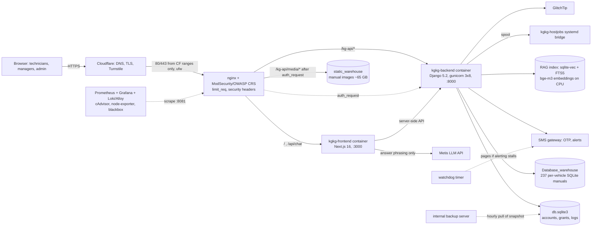

# Architecture evidence (criterion 1)

The maintained architecture documentation is in `docs/` and is versioned
with the code. This folder adds a deployment view checked against the
running system on 2026-10-27 and records where the documents were verified.

| Topic | Document |
|---|---|
| Product overview, users, roles, flows, glossary | `docs/01-overview.md` |
| System architecture, design principles, data flow, scaling path | `docs/02-architecture.md` |
| Data model (Django models, per-vehicle warehouse schema, RAG index schema) | `docs/03-data-model.md` |
| Module-by-module backend reference | `docs/04-backend-reference.md` |
| API specification (every endpoint, auth, parameters, errors, rate limits) | `docs/05-api-reference.md` |
| Authentication and authorization model | `docs/06-permissions-rbac.md` |
| Frontend routes, session handling | `docs/07-frontend.md` |
| AI assistant and RAG, diagnostic engine, LLM integration | `docs/08-ai-assistant-rag.md` |
| Realtime (SSE) and analytics | `docs/09-realtime-sse.md`, `docs/10-analytics-reporting.md` |
| Deployment, operations, runbooks | `docs/11-operations-deployment.md` |
| Security architecture and open risks | `docs/12-security.md` |
| Test architecture | `../01-requirements-and-traceability/TEST_STRATEGY.md` |
| Requirements → tests → defects traceability | `../01-requirements-and-traceability/TRACEABILITY.md` |

Not present and not claimed: a formal SRS in IEEE 830 form, a product
backlog tool export, or ADRs as separate files. Design decisions are
recorded inline in the docs ("why" sections) and in commit messages; the
traceability matrix in folder 01 plays the role of a requirements list for
the tested capabilities.

## Deployment view (verified against `docker ps`, nginx config and systemd on 2026-10-27)

Delivery path: GitHub Actions CI → server gate in a clean worktree → staging
containers (`:8110`/`:3107`) on a sanitized prod-DB copy → `kgkg-promote`
(person) → new backend container beside the old one on `:8000`
(`SO_REUSEPORT`), old one retired when healthy → smoke → automatic rollback
on failure. QA stack for E2E/load/DAST: `:8120`/`:3117` behind its own proxy
`:8130`.

## Verification notes (2026-10-27)

* Containers, ports, worker settings, mounts: checked with `docker ps`,
  `docker inspect` and `ops/docker/containers.sh` — match the diagram.
* `docs/12-security.md` §12.2 was stale in three rows (token storage,
  password reset, rate-limiter scope) and is corrected in this release.
* `docs/11-operations-deployment.md` gunicorn flags updated with the
  `--max-requests` change.
* Two nginx files existed only on the server; now versioned (defect D-08).
