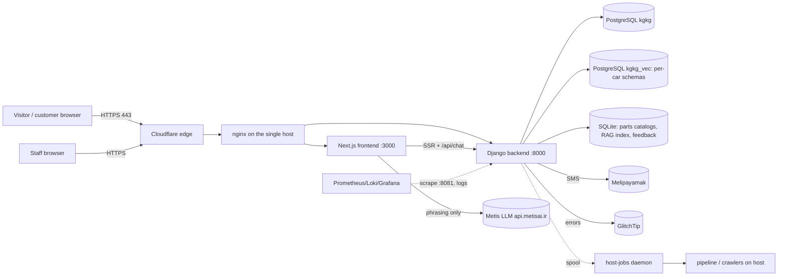
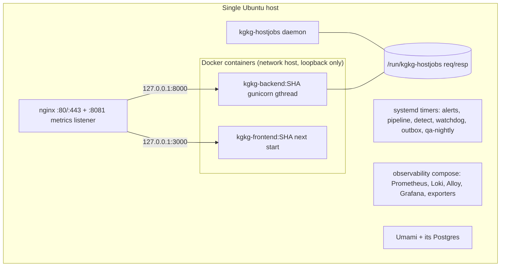
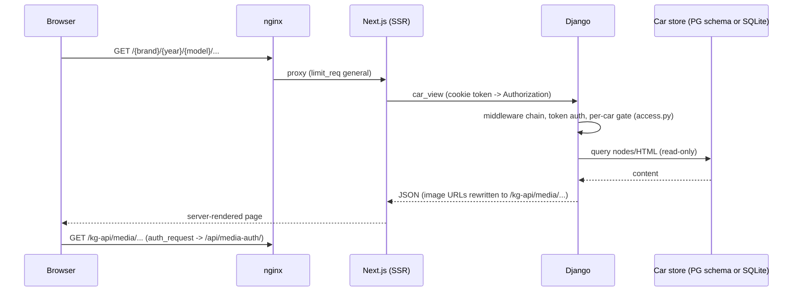

# 33 — System design (as implemented)

This document describes the system as the code and configuration in the repository define it, at `origin/work` @ `07f3ab5` **[C]**.
It corrects statements in [02-architecture.md](02-architecture.md) that predate the container deployment and TLS (see §33.12), and it
is the entry point for design questions. Production facts are tagged **[S]** only when taken from a dated read-only observation recorded in
another document; otherwise unverified production state is **[U]**. Persian version: [fa/33-system-design.md](fa/33-system-design.md).

## 33.1 System context

KGtechvault is a Persian (RTL) portal that sells per-company subscriptions to Toyota/Lexus service manuals and offers an assistant that
answers only from manuals a company has bought. [C] [01-overview.md](01-overview.md)

Boundaries: one physical host runs production, staging, QA and observability **[D]** (GitHub #25). Third-party dependencies named in code:
Metis (LLM, `api.metisai.ir`), Melipayamak (SMS, `console.melipayamak.com`), Cloudflare (TLS origin certificate, tunnel/Access for CI), GlitchTip/Sentry
SDK, Umami (self-hosted analytics), GitHub (CI). [C] `ops/observability/prometheus.yml`, `ops/nginx/kgkg.conf`, `settings.py`.

## 33.2 Runtime topology

- **nginx** (`ops/nginx/kgkg.conf`, `kgkg-limits.conf`, `kgkg-mediaauth.conf`): TLS 1.2/1.3 with a Cloudflare origin certificate on `kgtechvault.com`
  and `www.`; a separate loopback-only listener on `:8081` that serves exactly one location, `/kg-metrics` (bearer-protected, proxied to
  `/api/metrics/`), and denies everything else; `/kg-api/api/metrics/` is denied publicly. Rate-limit zones: general 30 r/s, static 100 r/s, API 20 r/s,
  **auth 30 r/min**, **chat 60 r/min**, admin 20 r/s; over-limit status 429.
- **Locations** (order in the file): media-auth subrequest `/_kg_media_auth`, VNC and Grafana auth subrequests (`/_kg_vnc_auth`, `/_kg_grafana_auth`),
  `/grafana/` (to `:3001`, admin-gated), `/kg-vnc/` (to `:6080`, admin-gated), `/kg-api/media/` (manual images, `auth_request`-protected, long cache),
  `/stats/` (Umami tracker to `:3002`), `/_next/static/`, per-endpoint auth limits (`login`, `verify-otp`, `resend-otp`, `recover/*`, `admin/login`), `/kg-api/api/invite/`,
  `/kg-api/api/admin/`, the SSE endpoint `/kg-api/api/events/stream/` (unbuffered), `/downloads/`, generic `/kg-api/` to Django, `/api/chat` to Next, and `/` to Next.
- **Containers** (`ops/docker/containers.sh`): both use the host network and bind loopback only; data stays on host disk via bind mounts (warehouse, static warehouse,
  logs, `.env.prod` read-only, HF model cache read-only); the backend has no other host access and requests host-side work through the host-jobs spool. Images are tagged by
  commit (`kgkg-backend:<sha>`, `kgkg-frontend:<sha>`); backend runs `gunicorn --worker-class gthread` (`KG_WORKERS` 3 × `KG_THREADS` 8 by default, `--timeout 300`).
- **Host processes:** systemd timers/services (alerts sweep, pipeline, detect, watchdog, outbox worker, QA nightly), the host-jobs daemon, the observability compose stack,
  Umami. Complete list: [25-ops-inventory.md](25-ops-inventory.md), [31-ops-files-reference.md](31-ops-files-reference.md).

## 33.3 Backend structure

One Django project, one app (`KG_backend/api/`), no DRF: plain `JsonResponse` views with token auth. Modules by responsibility (full list: [generated/inventory.md](generated/inventory.md)):

| Concern | Modules |
|---|---|
| HTTP surface | `urls.py`, `views_public.py`, `views_admin.py`, `views_admin_inbox.py`, `views_status.py`, `portal.py`, `requests_api.py`, `orggraph_api.py`, `chatlog.py`, `quota.py` |
| Identity and access | `portal_auth.py`, `admin_auth.py`, `access.py`, `mediaauth.py`, `originguard.py`, `shield.py`, `nulguard.py`, `ratelimit.py`, `contentguard.py` |
| Car content | `cardb.py`, `cardb_pg.py`, `parts.py`, `reads.py`, `listing.py`, `sst.py`, `labortimes.py` |
| Assistant | `rag/*` ([30](30-ai-assistant-deep-dive.md)), `assist_lookup.py`, `feedback.py`, `knowledge.py`, `flags.py` |
| Ingestion | `pipeline.py`, `ingest.py`, `parse_worker.py`, `partsingest.py`, `tis_crawler.py`, `partsouq_*.py`, `dataquality.py`, `hostjobs.py` |
| Real time | `events.py` (SSE bus), `signals.py` |
| Support | `support_chat/*`, `notifications/*`, `sla.py`, `support_metrics.py` ([35](35-support-system.md)) |
| Operations | `monitoring.py`, `alert_rules.py`, `metrics_exposition.py`, `audit.py`, `adminops.py`, `grafanaauth.py` |
| Analytics | `reporting.py`, `insights.py`, `behavior.py`, `recommend.py` |

### Middleware chain (order matters) [C] `settings.py`

1. `RequestMetricsMiddleware` — first so it times the whole stack; aggregates in memory and flushes in batches (no per-request DB write).
2. `SecurityMiddleware`; 3. `NulGuardMiddleware` (NUL in input → 400, not a PostgreSQL 500); 4. `SessionMiddleware`; 5. `CommonMiddleware`; 6. `CsrfViewMiddleware`;
7. `OriginGuardMiddleware` (cookie-authenticated writes from a foreign `Origin` → 403, defence in depth for the `@csrf_exempt` views); 8. `AuthenticationMiddleware`;
9. messages; 10. `XFrameOptionsMiddleware`; 11. `CorsMiddleware`; 12. `AuditMiddleware` (append-only audit of logins and every mutating API call);
13. `ContentGuardMiddleware` (per-user hourly caps on document reads and scraping alerts); 14. `ShieldMiddleware` (signed requests and sealed answers on content APIs when `KG_SHIELD=1`).

## 33.4 Frontend structure

Next.js 16 (App Router) with React 19, hand-written CSS with `data-theme` variables, Persian RTL. SSR pages call Django directly (`BACKEND_URL`, forwarding the portal
token from a same-site cookie); browser calls go to `/kg-api/…` (`NEXT_PUBLIC_API_BASE`). The only server-side API route that is not a proxy is `/api/chat`
(holds the Metis key, runs the assistant orchestration: [30](30-ai-assistant-deep-dive.md) §30.3). Details: [07-frontend.md](07-frontend.md), guidance tours
[13-guidance-system.md](13-guidance-system.md).

## 33.5 Request lifecycle (browse a manual page)

## 33.6 Authentication, authorization and access control

- **Identities:** `PortalUser` (company seat; password + SMS OTP second factor, device cookie `kg_dev`), `PlatformAdmin` (separate table, SMS second factor `AdminOtpChallenge`,
  optional `ADMIN_REQUIRE_2FA`), visitors (support chat bearer token). Opaque bearer session tokens are hashed at rest (`SessionTokenBase` → `AuthToken`, `AdminAuthToken`).
- **Authorization layers:** (1) route/auth class per view (`gq` auth map in the project graph); (2) company/car entitlement (`CompanyCarAccess`, `UserCarAccess`, `access.py`),
  (3) the org graph permission compilation (`OrgGraph`, `OrgNode`, `NodePermission`; [06](06-permissions-rbac.md)), (4) retrieval-level `allowed_cars` ([30](30-ai-assistant-deep-dive.md) §30.9),
  (5) nginx `auth_request` for media and admin tools, (6) support RBAC (`KG_SUPPORT_RBAC` off/audit/enforce; [35](35-support-system.md)).
- Complete session and OTP flow: [26-auth-and-sessions.md](26-auth-and-sessions.md); CSRF-exempt inventory: [21-csrf-exempt-views.md](21-csrf-exempt-views.md).

## 33.7 Real-time and asynchronous processing

- **SSE bus:** an append-only `Event` table (`audience`, `company_id`, indexes on `(audience,id)` and `(company_id,id)`); the endpoint tails it (1 s poll, 15 s heartbeat, 300 s
  recycle, `Last-Event-ID` resume), nginx streams it unbuffered; the client hook is `useEventStream`. No Redis by design ([02](02-architecture.md) principle 4; [09](09-realtime-sse.md)).
- **Support chat** uses polling for visitors (limit 30 polls/min/thread) and the staff inbox; see [35](35-support-system.md).
- **Outbox:** notifications are rows in `NotificationOutbox` written in the request's transaction, sent by a worker (`kgkg-outbox.timer/.service`); channel modes `off`/`dry_run`/`live`.
- **Pipeline:** `ProcessingJob`/`ZipPackage`/`PipelineSettings` drive parse → embed → graph → diag-build in detached transient units (`kgkg-pipeline-job<id>-a<n>`), resumable.
- **Host jobs:** the container cannot run host tools; `api/hostjobs.py` writes requests to `/run/kgkg-hostjobs/req`, the daemon (`ops/hostjobs/hostjobs_daemon.py`) executes an allow-listed set and writes `resp`.
- **Alerts:** `alert_rules.py` sweeps every 5 minutes (timer) and sends SMS with cooldown; the independent watchdog checks the sweep ([31](31-ops-files-reference.md) §31.5).

## 33.8 Caching, concurrency and performance

| Mechanism | Scope | Notes |
|---|---|---|
| Catalog/brand listing cache | per process, 60 s | existence checks TTL-cached (`cardb.ready_path`) |
| Car-store connection pool | per thread LRU (SQLite) | read-only, mmap, auto-reopen on file replacement |
| Registry cache of PG cars | per process, 60 s | `public.car_dbs` |
| Assistant exact/semantic caches | per process | keyed with `allowed_cars` ([30](30-ai-assistant-deep-dive.md) §30.5) |
| Embedding lock | per process | one embed at a time |
| Rate limits | nginx zones (shared) + `@rate_limited` counters in a SQLite file shared by the container's workers (in-process fallback) + the support-chat poll limiter (in-process, per worker) | only the fallback and the poll limiter multiply by worker count |
| Metrics aggregation | per process, batched flush | no per-request write |
| gunicorn | 3 workers × 8 threads default | I/O-bound reads; the ~2.3 GB embedding model loads once per process |

## 33.9 Deployment architecture

Gate → images → staging → promote → verify with automatic rollback; production promotion only by a person (`kgkg-promote <sha>`). Details and diagrams: [36-cicd-and-deployment.md](36-cicd-and-deployment.md).

## 33.10 Failure scenarios and recovery

| Failure | Behaviour [C] | Recovery |
|---|---|---|
| Metis down / unconfigured / over budget | assistant answers with a deterministic digest, no charge | none needed; restore keys/budget |
| Embedding model mismatch | RAG endpoints raise until the model matches the index | set `RAG_EMBED_MODEL` or rebuild |
| RAG index missing | site search falls back to keyword search; assistant returns 502 | rebuild with `build_rag` |
| Backend container unhealthy during deploy | new container never receives traffic; old one keeps :8000; smoke failure triggers rollback to previous images | `deploy.sh --rollback` |
| Migration applied then rollback | migrations are **not** reversed (additive only); pre-deploy DB backup kept | restore backup manually |
| Alerting engine dies | watchdog (independent, system python) pages by SMS | restart sweep; see runbooks |
| Host network down | probes fail together; alert only after `KG_ALERT_NETWORK_DOWN_MIN` | restore network |
| Loss of `kgkg_vec` / `_parts` / static images | **no verified backup** (risk R1, [27](27-open-risks-and-decisions.md)) | rebuild from source ZIPs is not demonstrated **[U]** |
| Staging misconfiguration | staging read production `kgkg_vec` (risk R5) **[S 2026-11-03]** | owner decision pending |

## 33.11 Known architectural limitations

Single host and single point of failure; per-process caches and limiters; SSE via DB polling; the Django ORM and `cardb_pg` translator cover only a subset of SQL the SQLite code used;
no CSRF tokens on `@csrf_exempt` views (mitigated by `OriginGuard` and SameSite) — see [21](21-csrf-exempt-views.md), [27](27-open-risks-and-decisions.md).

## 33.12 Corrections to older architecture text

[02-architecture.md](02-architecture.md) still says nginx is "HTTP only — no TLS yet" and shows `systemd: kgkg-backend, kgkg-frontend`; the repository's nginx configuration terminates TLS with a
Cloudflare origin certificate, and the deploy runs both applications in Docker containers (`ops/deploy/deploy.sh`, `ops/docker/`). Whether the legacy `kgkg-backend.service` still exists on the host is **[U]**
(risk register). Treat this document and the code as authoritative where they differ from 02.

## 33.13 Architectural decisions

ADR-0001 (SQLite, per-vehicle DBs; amended in part by ADR-0007, Proposed), ADR-0002 (deterministic local retrieval, LLM as phraser), ADR-0003 (containers with zero-gap swap), ADR-0004 (only a person promotes), ADR-0005 (self-hosted error monitoring), ADR-0006 (docs as code), ADR-0007 (PostgreSQL stores, retrospective, Proposed). Index: [adr/README.md](adr/README.md).
