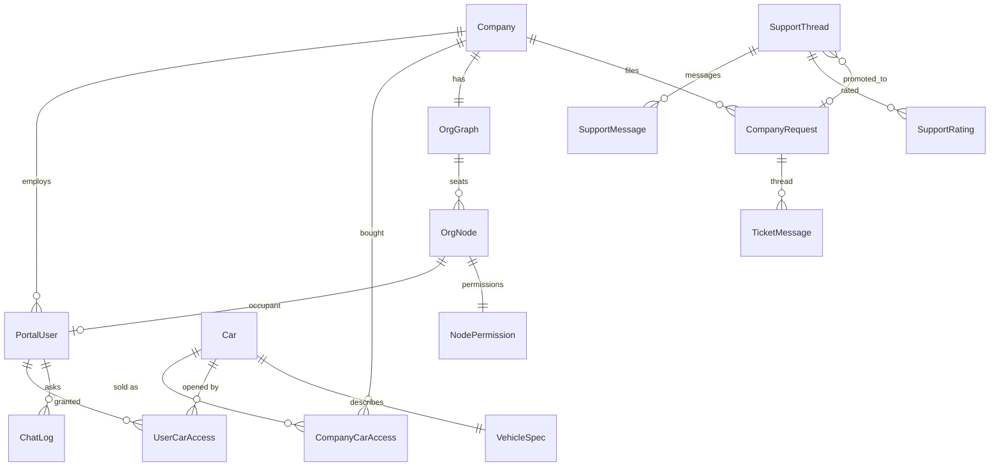

# 34 — Data model reference (entities, relationships, lifecycle, access patterns)

Narrative companion to the machine-generated [generated/schema.md](generated/schema.md) (every model in `api/models.py`, `api/support_chat/models.py` and `api/notifications/models.py`: every field, relation, index and constraint declared in code, plus an
ER diagram; regenerate with `python3 ops/governance/gen_schema.py`, checked in CI). Storage tiers outside Django (PostgreSQL `kgkg_vec`, SQLite parts catalogs, RAG
index) are in [23-data-layer.md](23-data-layer.md) and [03-data-model.md](03-data-model.md). Revision `origin/work` @ `07f3ab5` **[C]**; the live database was not
inspected, so table contents, row counts, real indexes and applied-migration state are **[U]**. Persian version: [fa/34-data-model-reference.md](fa/34-data-model-reference.md).

## 34.1 Storage tiers at a glance

| Tier | Engine and database | Holds | Authoritative description |
|---|---|---|---|
| Portal | PostgreSQL 16 `kgkg` (SQLite file in development) | all Django models below | this document, `generated/schema.md` |
| Vehicle content (manual cars) | PostgreSQL `kgkg_vec`, schema `car_<md5 of file name>` per car, registry `public.car_dbs` | node trees, HTML, DTC and symptom tables | [23](23-data-layer.md), [15](15-vehicle-schema.md) |
| Vehicle content (parts-only cars) | one read-only SQLite file per car under `Database_warehouse/_parts/` | parts catalog | [16](16-parts-catalog.md) |
| Derived RAG | `_rag/index.rag.db` (SQLite, FTS5, sqlite-vec), `_rag/diag/*.db`, optional pgvector mirror | blobs, occurrences, vectors, graph, diagnostic sidecars | [30](30-ai-assistant-deep-dive.md) |
| User-data sidecar | `_rag/feedback.db` (SQLite) | assistant query log, ratings, clicks, expert pins | [30](30-ai-assistant-deep-dive.md) §30.10 |
| Files | `static_warehouse/<car>/` images, quarantine, reports | media | [25](25-ops-inventory.md) |

The `Car` model is the bridge: `db_table = 'main_db'`, one row per vehicle, whose file-name key locates that vehicle's content store (SQLite file or PostgreSQL schema).
PostgreSQL and SQLite are not interchangeable here: `cardb_pg.py` translates only a subset of SQL, and `adopt()` deletes the SQLite file after loading
([23](23-data-layer.md)).

## 34.2 Entity groups

### Catalog and entitlement
`Car` (vehicle row) ← `CompanyCarAccess` (what a company bought: unique `(company, car)`, with document layers) ← `UserCarAccess` (per-user grant within the company's purchase:
unique `(user, car)`). `VehicleSpec` is one-to-one with `Car` (schema.org-shaped structured specification). `PurchaseRequest` is the visitor's pre-account request to buy.

### Tenancy and identity
`Company` (legal entity; `CompanyRole` labels, unique `(company, value)`), `PortalUser` (company seat; self-references `reports_to` and `invited_by`), `PlatformAdmin`
(vendor staff, separate from seats). Sessions: abstract `SessionTokenBase` → `AuthToken` (portal) and `AdminAuthToken` (admin), opaque tokens stored hashed. Second factor:
`OtpChallenge`, `AdminOtpChallenge`, `OtpEvent` (sent/wrong-code ledger, index `(user, kind, at)`). Devices: `KnownDevice` (unique `(user, device_hash)`), `RetiredDevice`.
Invitations: `InviteToken` (single-use, expiring), `NodeInvite` (bound to an empty seat).

### Organisation graph and delegation
`OrgGraph` (one per company) → `OrgNode` (seat; `parent` tree; occupant one-to-one `PortalUser`; DB constraint `one_root_per_graph` — at most one root per graph) →
`NodePermission` (root-assigned permission set, compiled into effective grants). Delegation rule: a manager can only grant access they hold ([06](06-permissions-rbac.md)).

### Requests and tickets (logged-in customers)
`CompanyRequest` (filed by a manager, assigned to a `PlatformAdmin`; indexes `(company,status)`, `(status,created_at)`) → `TicketMessage` (author is a user or an admin) and `TicketRead`
(read marker; unique per `(request,user)` and `(request,admin)`; a `CheckConstraint` requires exactly one of user/admin).

### Anonymous support chat
`SupportThread` (UUID primary key; `token_hash` unique; status machine; optional `promoted_request` → `CompanyRequest`), `SupportMessage`, `SupportRating`, `SupportPresence`.
Kept separate from tickets on purpose so a defect in anonymous endpoints cannot expose company data ([35](35-support-system.md)). Notification delivery rows live in
`api/notifications/models.py` (`NotificationOutbox`).

### Knowledge base and feedback
`KnowledgeArticle` → `KnowledgeRevision` (unique `(article, version)`), `KbSearchLog`, `Feedback` (unsolicited product feedback), `FeatureFlag` (A/B and rollout).

### Assistant and analytics logs
`ChatLog` (one assistant exchange: question, gated answer, mode, flags, tokens, cost; indexes `(company,created_at)`, `(user,created_at)`), `SearchLog` (plain ids, **no FKs**, so analytics survive
deletions), `ActivityLog` (usage events; indexes on `(user,created_at)`, `(category,created_at)`, `(created_at)`, `(user,action)`), `TrafficStat` (per endpoint rollup, unique `(bucket,endpoint,method)`),
`VisitorSeen` (unique `(day, ip_hash)`: exact daily unique visitors with a salted IP hash).

### Operations and audit
`AuditLog` (append-only; `ordering -id`; indexes on actor, company, outcome, ip with `created_at`), `Event` (SSE bus; indexes `(audience,id)`, `(company_id,id)`), `SystemAlert`, `SystemState`
(key → JSON store for cross-worker singletons), `ProcessingJob`, `ZipPackage` (parse queue), `PipelineSettings` (singleton row id=1), `DataQualityRun`, `NotificationLog` (SMS dedupe ledger).

## 34.3 Entity-relationship overview (core)

The complete declared relation set (every foreign key) is in [generated/schema.md](generated/schema.md).

## 34.4 Lifecycles

- **Company onboarding:** `PurchaseRequest` → admin approval → `Company` + `CompanyCarAccess` + first `PortalUser` (invite or provision) → `UserCarAccess` per seat ([00-srs.md](00-srs.md) FR-01/02).
- **Session:** login (password) → `OtpChallenge` → verify → `AuthToken` (hashed, server-side revocable; one live session per account) → logout deletes/revokes ([26](26-auth-and-sessions.md)).
- **Support thread:** `open` ⇄ `waiting_staff` ⇄ `waiting_customer` → `closed` (reopenable for `KG_SUPPORT_REOPEN_DAYS`, default 14) or `spam`; promotion to a ticket sets `promoted_request` ([35](35-support-system.md)).
- **Content ingestion:** `ZipPackage` discovered → `ProcessingJob` stages → vehicle content store created/loaded → `Car` row synced (`sync_car_catalog`) → RAG index and diag sidecars built → `DataQualityRun` audits.
- **Events:** `Event` rows are append-only; consumers tail by id; old rows are pruned by maintenance (retention not verified **[U]**).

## 34.5 Constraints and integrity rules enforced by the database [C]

| Rule | Where |
|---|---|
| One root seat per org graph | `OrgNode` `UniqueConstraint(graph) where is_root` (`one_root_per_graph`) |
| One purchase row per (company, car); one grant per (user, car) | `unique_together` on `CompanyCarAccess`, `UserCarAccess` |
| One rating per closure of a thread | `supportrating_one_per_closure` |
| A client-retry cannot duplicate a support message | `supportmessage_client_id_once_per_thread` (non-empty `client_id`) |
| A ticket read marker belongs to exactly one of user/admin | `TicketRead` `CheckConstraint` + two uniqueness constraints |
| Revision numbers unique per article | `KnowledgeRevision` unique `(article, version)` |
| Support-chat NOT NULL columns have `db_default` | rollback safety: the previous release can still insert |

Migrations are additive only (`ops/deploy/check_migrations.py`); the deploy never reverses a migration.

## 34.6 Access patterns and performance notes

- Hot read paths use indexes declared on `ActivityLog`, `AuditLog`, `Event`, `ChatLog`, `SearchLog`, `SupportMessage (thread,id)`. Breadcrumbs use one recursive CTE per page.
- Car content is read through `api/cardb.py` (`connect()` → SQLite file or `PgCarConn`), never through the ORM; keys are file names.
- Writes to usage/log tables are batched (`TrafficStat` flush) or append-only; `SearchLog` and `Event` avoid FKs to keep writes cheap and robust against deletion.
- Heavy rollups are computed in the application (`reporting.py`, `insights.py`), not stored views.

## 34.7 Backup, retention and recovery (state of knowledge)

Deploy takes a database backup before migrating (`deploy.sh`, kept under `/opt/KGKG_release/db-backups`) and an hourly off-host snapshot exists **[D]**, but the verified
coverage is `kgkg` only; `kgkg_vec`, the parts SQLite files and static images have **no verified backup** (risk R1, [27](27-open-risks-and-decisions.md)). Support-chat retention is
configured but deletion needs an explicit switch ([35](35-support-system.md) §35.8). Do not assume any table is recoverable until R1 is closed.

## 34.8 How to change the model

1. Edit `models.py`; add an additive migration (no drops/renames of live columns; give new NOT NULL columns a `db_default`).
2. `python3 ops/governance/gen_schema.py` and commit `docs/generated/schema.md`; update the narrative above if a group or constraint changed.
3. `python manage.py makemigrations --check --dry-run` and the backend suite must pass; update `docs/openapi.yaml` if an API shape changed.
