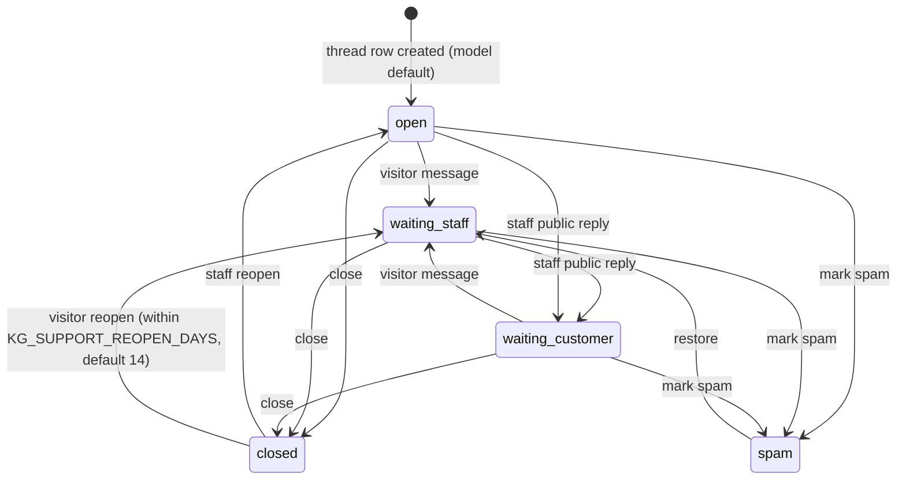

# 35 — Customer support system (visitor chat, staff inbox, tickets, notifications)

Deep reference for what the code implements at `origin/work` @ `07f3ab5` **[C]**. It extends [22-support-chat.md](22-support-chat.md) (code map and security properties) and
[24-integrations.md](24-integrations.md). Whether any capability is switched on in production is **[U]**: the host was not inspected. Persian version:
[fa/35-support-system.md](fa/35-support-system.md). Design records: `docs/superpowers/specs/2026-11-02-customer-communication-design.md`,
`2026-11-03-phase3-migration-and-rbac-design.md` (dated, historical).

## 35.1 Two channels, deliberately separate

| Channel | Who | Tables | Auth |
|---|---|---|---|
| **Tickets** | logged-in company managers and platform admins | `CompanyRequest`, `TicketMessage`, `TicketRead` | portal/admin bearer token |
| **Support chat** | anonymous visitors (before they have an account) and staff | `SupportThread`, `SupportMessage`, `SupportRating`, `SupportPresence` | visitor: per-thread bearer token; staff: admin session |

A bug in the anonymous endpoints therefore cannot expose company-scoped ticket data. A thread can be *promoted* into a ticket (`SupportThread.promoted_request`); the ticket
tables know nothing of the thread.

## 35.2 Capability status (what exists, what is off)

| Capability | State | Switch / basis |
|---|---|---|
| Visitor chat widget and endpoints | **Implemented; dark unless enabled** | `KG_SUPPORT_CHAT_ENABLED=1` gates only *new* threads; existing threads and staff replies keep working when off |
| Staff inbox (list, detail, reply, close, reopen, seen, assign, priority, intent, spam, restore) | Implemented | admin session; RBAC mode below |
| Presence ("is anyone live") | Implemented | window `KG_SUPPORT_PRESENCE_WINDOW_S` (60 s) |
| Role-based access for support | **Implemented, off by default** | `KG_SUPPORT_RBAC` = `off` (default) / `audit` / `enforce` (unrecognised value ⇒ `enforce`) |
| Notification outbox (SMS, e-mail) | Implemented; **channels off by default** | `KG_NOTIFY_SMS`, `KG_NOTIFY_EMAIL` = `off`/`dry_run`/`live`; typo ⇒ `off` |
| Reply-time promise to customers | **Not offered** | `KG_SUPPORT_REPLY_TARGET_MINUTES` unset by design |
| Retention enforcement | **Report-only** | deletion needs `KG_SUPPORT_RETENTION_ENABLED=1` **and** `purge_support_chat --apply` |
| Thread event timeline | Not implemented | traceability uses `AuditLog` (ids only) |
| Browser E2E for the chat | Tested in CI | job `support-chat-e2e` (21 tests at the time of the earlier note) |
| Production activation | **[U]** | privacy notice draft unpublished; backup retention unknown (R1/R5) |

## 35.3 Conversation lifecycle

Transitions are explicit and each close/reopen writes a system-authored line (`گفتگو بسته شد.` / `گفتگو دوباره باز شد.`) so history never silently changes state (`lifecycle.py`; callers hold a
row lock). Reopening increments `reopen_count`; a satisfaction rating (`SupportRating`, score) is allowed once per closure (`closure = reopen_count`). The diagram was checked against the status assignments in `views_public.py`, `views_admin.py` and `lifecycle.py`; a visitor message to a spam thread is refused, and restore goes to `waiting_staff`. Re-read those files before changing a transition.

## 35.4 Visitor API (anonymous) [C] `support_chat/urls.py`

| Route | Purpose |
|---|---|
| `GET api/support-chat/status/` | widget availability (enabled, staff presence, reply target) |
| `POST api/support-chat/threads/` | create (idempotent when the client supplies its own 43-char token) |
| `GET/POST api/support-chat/threads/<id>/messages/` | poll / send (`client_id` makes retries safe) |
| `POST …/contact/` | add name, phone, e-mail (validated) |
| `POST …/reopen/`, `POST …/csat/` | reopen own thread; rate the closure |

Input rules (`limits.py`): body ≤ 2000 characters, control characters stripped, invisible-only bodies rejected; intent ∈ {sales, demo, technical, other}; `source_page` is stored
without query or fragment and `referrer` as scheme://host/path only (query strings can carry personal data); phone is normalised and must be 10–15 digits; e-mail is shape-checked
by a linear scan (no regex backtracking).

## 35.5 Identity, tokens and session handling

A visitor token is 32 random bytes, URL-safe base64 without padding (exactly 43 characters); only its SHA-256 is stored (`SupportThread.token_hash`, unique), so a database leak does
not hand out conversations. The client may generate its own token so thread creation is idempotent. Wrong token and missing thread both yield 404 (`authorise` uses `hmac.compare_digest`);
malformed tokens are rejected before any query. Visitor identity beyond that is not collected: `ua_hash` is a hash, contact fields are optional.

## 35.6 Staff side

Endpoints under `api/admin/support-chat/…`: presence and heartbeat; thread list/detail; `reply`, `close`, `reopen`, `seen`, `assign`, `priority`, `intent`, `spam`, `restore`. `staff_seen_at`
is one shared mark (not per admin) that drives the visitor's "read" tick and the inbox unread dot. Internal notes (`SupportMessage.internal`) are never serialised to the visitor.

**RBAC** (`rbac.py`, facade `permissions.py`): permissions `support.read, reply, take, assign, priority, intent, close, reopen, spam, reveal_contact, exclude, metrics, notify_health, availability, roles`.
Roles and what they hold:

| Role | Intents | Permissions (scope) |
|---|---|---|
| `support_agent` | technical, other | read/reply/take (own or unassigned); priority/intent/close/reopen/reveal_contact (own); availability |
| `sales_agent` | sales, demo | same matrix as agent |
| `support_lead` | all | everything except `roles`, across all threads |
| `support_auditor` | all | read, metrics, notify_health (read-only) |
| `support_owner` | all | lead set plus `roles` |

Modes: `off` (every signed-in platform admin person may do everything — today's behaviour), `audit` (same access, would-be denials written as id-only audit rows), `enforce` (default deny;
if no active owner resolves, support endpoints answer 403 `rbac_no_owner`; recover with `KG_SUPPORT_OWNERS`, the `support_roles` command or `KG_SUPPORT_RBAC=off`). Out-of-scope threads answer 404
(no existence oracle). The loopback `KG_ADMIN_TOKEN` is never a person and holds no support permission. Role storage beyond `KG_SUPPORT_OWNERS` (the `SupportStaffRole` table) depends on a later migration
(**[U]** whether applied).

## 35.7 Real-time behaviour, rate limits and load

- **Updates:** server events `support_chat.message` and `support_chat.updated` go on the shared SSE bus (`events.emit`); the frontend connector uses SSE with a polling fallback and a 45 s stall watchdog
  (`kg_frontend/src/utils/eventStreamConnector.js`, [09](09-realtime-sse.md)). The visitor poll endpoint is rate-limited to 30/min/thread (3 s polling = 20/min).
- **Limits** (`config.py`, override `KG_SC_<NAME>="N/seconds"`, `0/0` disables): poll 30/60 s per thread; send 20/60 s per thread; send_hour 30/3600 s; contact 10/60; csat 5/60; reopen 5/60;
  create 20/600 s per IP; failed-token checks 30/60 s per IP; status 60/60 s per IP. Keyed by thread token, not IP, so shared NATs do not eat each other's allowance. The poll limiter is per
  gunicorn worker, in process (effective allowance up to workers × value); the other limits use the shared store of `api/ratelimit.py`. A limiter fault never takes the chat down (fails open). nginx adds a `kg_chat` zone (60 r/min).
- **Load test:** `qa/k6/support_chat_poll.js` (100 VUs / 60 s default) measures polling cost ([32](32-testing-and-qa.md) §32.6); no recorded result is committed **[U]**.

## 35.8 Privacy and retention

Stored: message text, optional name/phone/e-mail, source page and referrer (query-stripped), UA hash. Retention is **proposed, not enforced**: no-contact threads 30 days, with-contact 180, spam 7,
promoted 30 (`KG_SUPPORT_RETENTION_*_DAYS`); `manage.py purge_support_chat` reports by default and deletes only with `KG_SUPPORT_RETENTION_ENABLED=1` and `--apply`; deleting a thread deletes its
messages and ratings; **backups are not touched**. Staging/QA copies mask support-chat contact data and the referrer (`sanitize_staging_db.py`, fails closed). The privacy notice is an unpublished draft.

## 35.9 Customer communication outbox (`api/notifications/`)

Request code never talks to a provider: `service.enqueue(...)` writes a `NotificationOutbox` row in the same transaction as the event, so a crash cannot lose a notification and a rolled-back message
cannot leave one behind. A worker (`manage.py process_outbox`; unit `ops/outbox/kgkg-outbox.service` + `.timer`) sends rows, retries with backoff and marks them `dead` visibly.

- Statuses: `queued, sending, sent (provider accepted, not proof of delivery), failed (retry at next_attempt_at), dead, suppressed (channel was off when written), dry_run`.
- `dedupe_key` is unique when set; callers bucket by time window (`window_key`) to coalesce bursts into one notification.
- Channels and modes: `KG_NOTIFY_SMS`, `KG_NOTIFY_EMAIL` ∈ `off` (default; rows written as `suppressed`), `dry_run` (render and log), `live`.
- Providers (`providers.py`): `send` never raises; SMS through Melipayamak (accepted when its `Value > 1000`; dotted names/numbers are treated as links by the operator, so bodies avoid them; opt-out footer `لغو11`),
  e-mail through SMTP (`EMAIL_*`, `KG_NOTIFY_FROM_EMAIL`). Delivery receipts and bounces are **not observed**.
- Health: `manage.py support_health` prints how many visitors wait for a human reply and for how long (warn 300 s, crit 900 s by default; read-only, not wired into alerts by design).

## 35.10 Operational workflows

1. Before enabling publicly: `support-chat-e2e` green; privacy notice approved; backup/retention known (R1/R5); decide `KG_SUPPORT_RBAC` mode and bootstrap owners (`KG_SUPPORT_OWNERS`).
2. Enable: set `KG_SUPPORT_CHAT_ENABLED=1` and restart (`deploy.sh --reload`). Kill: unset it; existing threads continue.
3. Staff: mark availability (heartbeat), triage by intent, assign, reply; close when done; mark spam; promote to a ticket when the visitor is a customer.
4. Watch: `support_health`, `admin/support/metrics/` (`support_metrics.py`), SLA (`sla.py`), `_qa` and alert rules; runbook R10 in [20-runbooks.md](20-runbooks.md).
5. Disable a channel instantly: set its `KG_NOTIFY_*` to `off`.

## 35.11 Tests

`api/support_chat/test_*.py` (security sweep, RBAC and API, lifecycle, throttling, tokens, privacy, purge, presence, staff actions, concurrency, load, benchmark, inbox API, health),
`api/notifications/test_*.py` (command, models, privacy and concurrency, providers, service, worker), frontend `support.test.mjs`/`desk.test.mjs`, Playwright `support-chat.spec.js` and `support.spec.js`.
Coverage percentages are not recorded here ([32](32-testing-and-qa.md) §32.2).

## 35.12 Known gaps

No thread event timeline; retention periods not approved and purge disabled; reply-time promise unset; delivery receipts unobserved; production activation state and `SupportStaffRole` migration state unverified;
per-worker poll limiter; privacy notice unpublished.

Production observation (2026-11-04, read-only, commit `8a380f6`): migration `0041_support_chat_core` is applied, the public status endpoint reports `enabled=false`, no `KG_SUPPORT_*` or `KG_NOTIFY_*` variable is set, the chat and outbox tables hold 0 rows and `kgkg-outbox.timer` is not installed. So the activation state is now **known: deployed, disabled, unused** ([38](38-implementation-status-matrix.md) §38.4); `SupportStaffRole` enforcement is off (`KG_SUPPORT_RBAC` unset).
