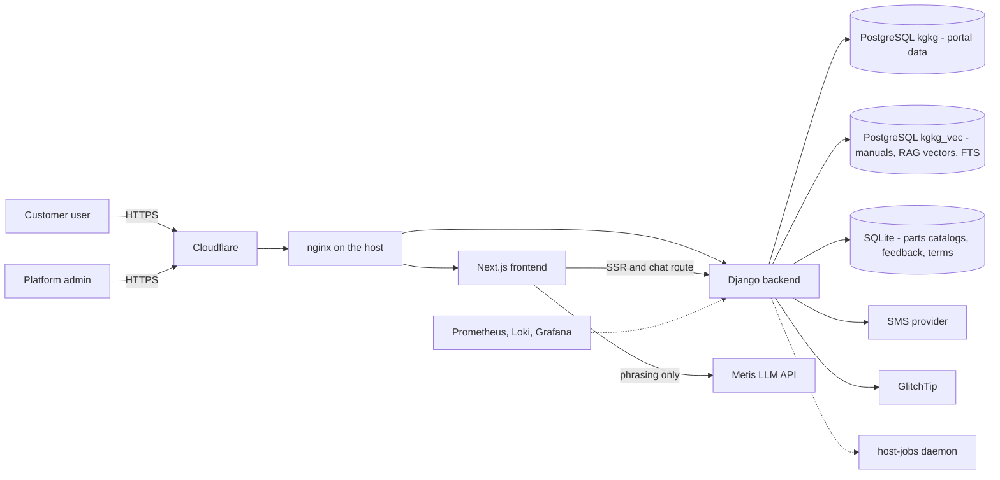
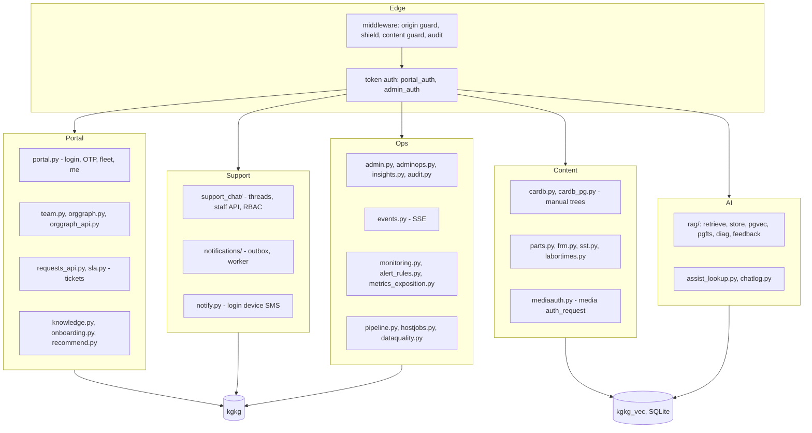
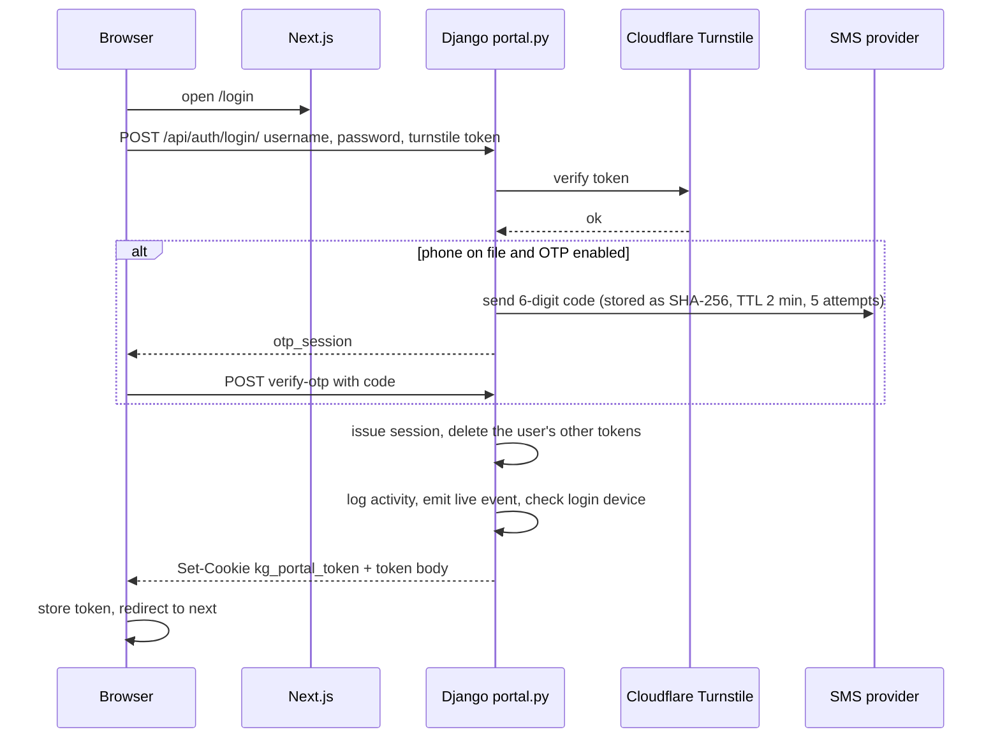
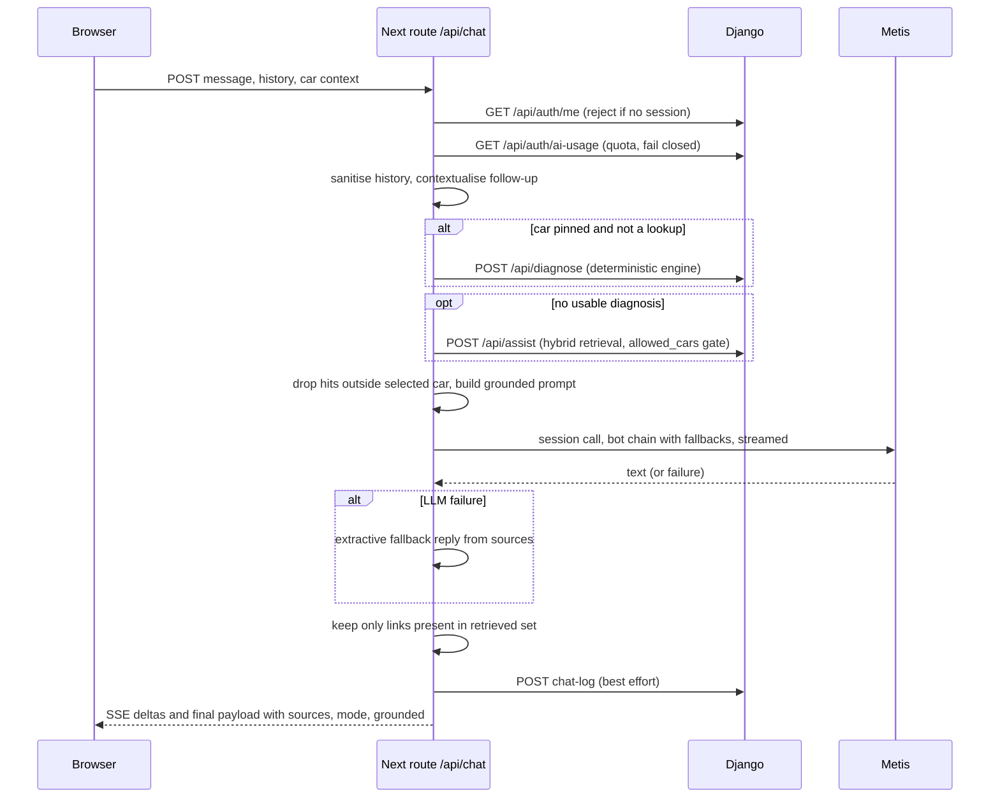
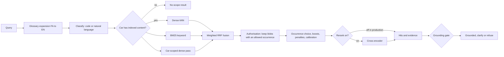
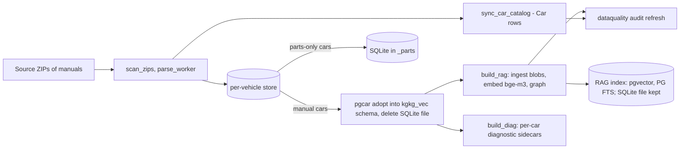
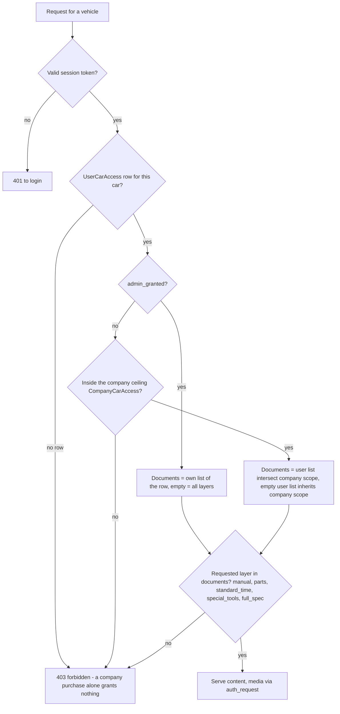
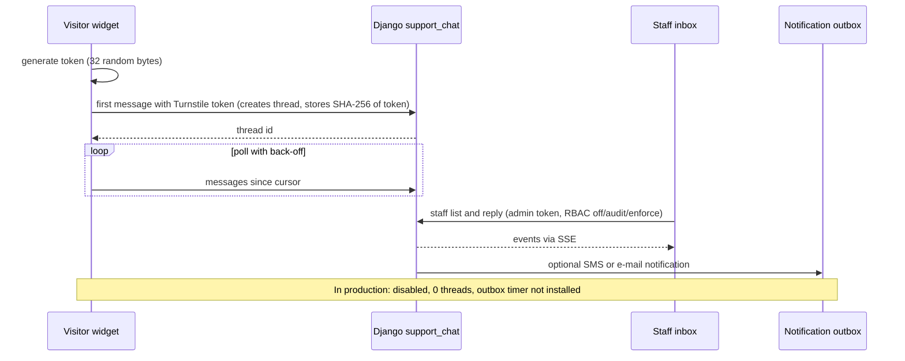
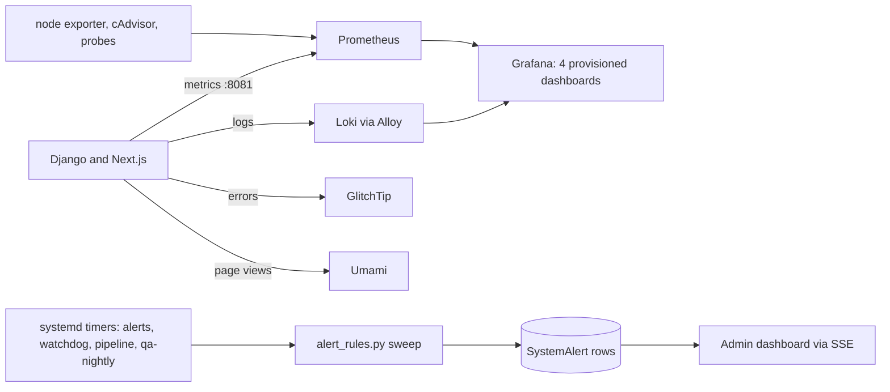
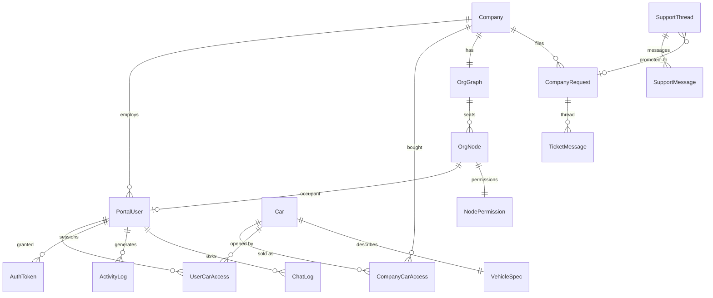

# 43 — Architecture and data-flow diagrams

One place for the diagrams, drawn from the implementation. Persian version: [fa/43-architecture-diagrams.md](fa/43-architecture-diagrams.md). Every diagram names the document and code it comes from; production state is as observed on 2026-11-04 ([38](38-implementation-status-matrix.md)). The full entity-relationship diagram of all 49 models is generated, so it cannot drift: [generated/schema.md](generated/schema.md). Diagrams that already live elsewhere are linked, not copied: system context and containers [33 §33.1–33.2](33-system-design.md), manual page request [33](33-system-design.md), support thread states [35](35-support-system.md), release pipeline [36](36-cicd-and-deployment.md).

## 43.1 System context (who talks to whom)

Source: [33](33-system-design.md), [38 §38.3, 38.5](38-implementation-status-matrix.md) (production reads RAG vectors and FTS from `kgkg_vec`).

## 43.2 Backend component map

Source: module list `KG_backend/api/`, [04](04-backend-reference.md), [33](33-system-design.md).

## 43.3 Portal login with SMS second factor

Source: [26 §26.2](26-auth-and-sessions.md), `utils/api.jsx`, `app/login/page.tsx`.

## 43.4 Assistant request lifecycle

Source: [30 §30.3, 30.7–30.8](30-ai-assistant-deep-dive.md), `app/api/chat/route.js`.

## 43.5 Retrieval pipeline (inside `/api/assist`)

Source: [30 §30.5](30-ai-assistant-deep-dive.md). Production storage: pgvector and PostgreSQL full-text search; reranker off ([38](38-implementation-status-matrix.md)).

## 43.6 Content ingestion and processing flow

Source: [11 §11.6](11-operations-deployment.md), [23 §23.2](23-data-layer.md), [30 §30.4](30-ai-assistant-deep-dive.md), `api/pipeline.py`, `management/commands/run_pipeline.py`. Stages are incremental and resumable; a stage failure does not stop later safe stages.

## 43.7 Access resolution (who can open which vehicle)

Source: [06 §6.2–6.3](06-permissions-rbac.md), `access.user_car_documents`; seat permissions from the org graph feed these rows ([06 §6.6](06-permissions-rbac.md)). The assistant applies the same grants as `allowed_cars` inside retrieval.

## 43.8 Support chat message path (feature deployed, disabled in production)

Source: [22](22-support-chat.md), [35](35-support-system.md), `src/support-chat/*`. Thread states: [35](35-support-system.md).

## 43.9 Observability and alerting flow

Source: [25](25-ops-inventory.md), [31](31-ops-files-reference.md), `api/monitoring.py`, `api/alert_rules.py`. Dashboard contents were not inspected ([38](38-implementation-status-matrix.md)).

## 43.10 Domain data model (core subset; full diagram in the generated schema)

Source: [34](34-data-model-reference.md), [generated/schema.md](generated/schema.md) (authoritative for every foreign key).

## 43.11 Release and deployment flow

See the pipeline flowchart in [36](36-cicd-and-deployment.md) (PR → CI → stage by CI key → smoke → **person promotes with `kgkg-promote`** → zero-gap swap with automatic rollback) and the container/host diagram in [33](33-system-design.md). Promotion is never automated.
