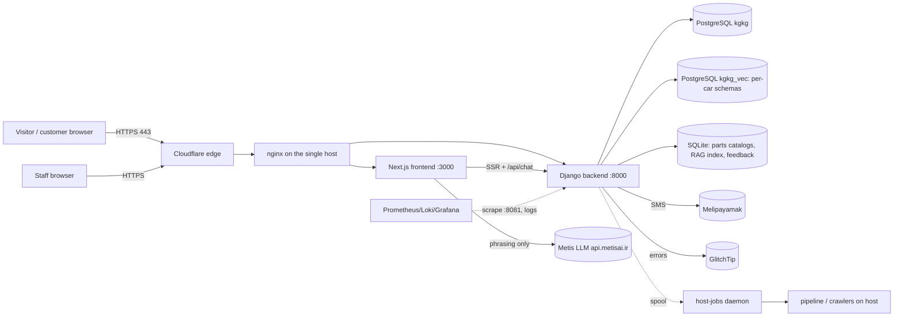
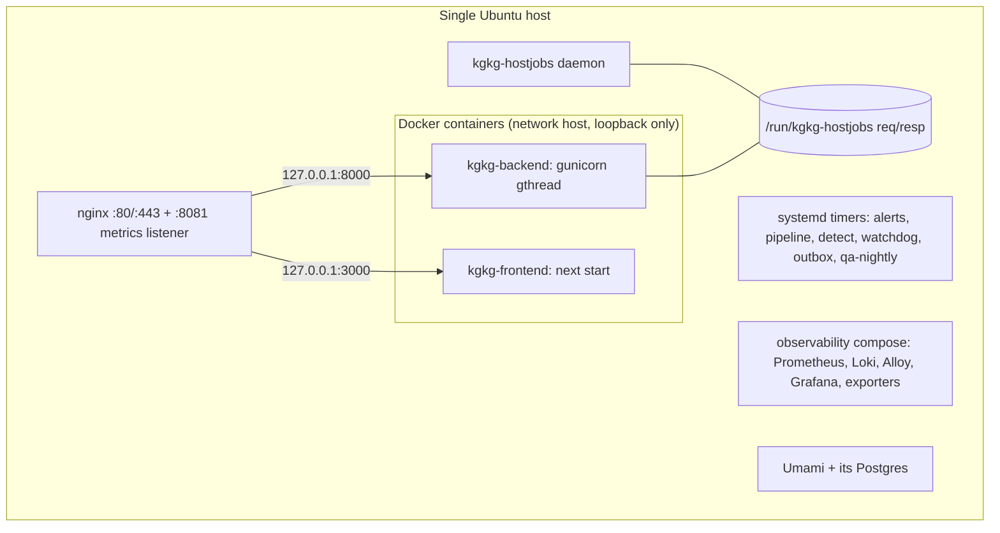
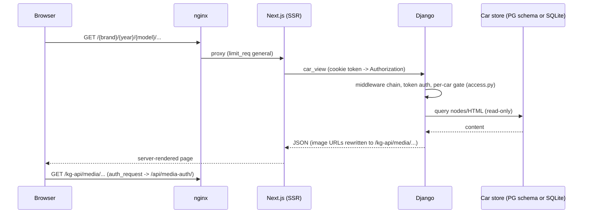

<!-- i18n-source: 33-system-design.md sha256:9378fab17085 -->

# ۳۳ — طراحی سیستم (آنچه پیاده‌سازی شده)

این سند سیستم را همان‌گونه که کد و پیکربندی مخزن تعریف می‌کنند، در `origin/work` نسخهٔ `07f3ab5` شرح می‌دهد **[C]**. مواردی از [02-architecture.md](../02-architecture.md) را که به پیش از استقرار کانتینری و TLS برمی‌گردند اصلاح می‌کند (بخش ۳۳٫۱۲) و نقطهٔ ورود پرسش‌های طراحی است. واقعیت تولید فقط وقتی **[S]** است که از مشاهدهٔ فقط‌خواندنیِ تاریخ‌دار ثبت‌شده در سند دیگری آمده باشد؛ در غیر این صورت **[U]** است. نسخهٔ انگلیسی: [../33-system-design.md](../33-system-design.md).

## ۳۳٫۱ زمینهٔ سیستم

KGtechvault یک پورتال فارسی (راست‌به‌چپ) است که اشتراک شرکتی دفترچه‌های سرویس تویوتا/لکسوس می‌فروشد و دستیاری دارد که فقط از دفترچه‌هایی که شرکت خریده پاسخ می‌دهد. [C] [01-overview.md](../01-overview.md)

مرزها: یک میزبان فیزیکی تولید، staging، QA و مشاهده‌پذیری را اجرا می‌کند **[D]** (GitHub #25). وابستگی‌های ثالثی که در کد نام برده شده‌اند: Metis (LLM، `api.metisai.ir`)، Melipayamak (پیامک، `console.melipayamak.com`)، Cloudflare (گواهی مبدأ TLS، tunnel/Access برای CI)، SDK مربوط به GlitchTip/Sentry، Umami (تحلیل خودمیزبان) و GitHub (CI). [C] `ops/observability/prometheus.yml`، `ops/nginx/kgkg.conf`، `settings.py`.

## ۳۳٫۲ توپولوژی زمان اجرا

- **nginx** (`ops/nginx/kgkg.conf`، `kgkg-limits.conf`، `kgkg-mediaauth.conf`): TLS نسخهٔ ۱٫۲/۱٫۳ با گواهی مبدأ Cloudflare برای `kgtechvault.com` و `www.`؛ یک شنوندهٔ جداگانهٔ فقط‌حلقوی روی `:8081` که دقیقاً یک location دارد یعنی `/kg-metrics` (محافظت‌شده با bearer و پراکسی به `/api/metrics/`) و بقیه را رد می‌کند؛ مسیر `/kg-api/api/metrics/` در عموم مسدود است. منطقه‌های محدودیت نرخ: عمومی ۳۰ درخواست بر ثانیه، استاتیک ۱۰۰، API ‏۲۰، **احراز هویت ۳۰ در دقیقه**، **چت ۶۰ در دقیقه**، ادمین ۲۰ بر ثانیه؛ وضعیت عبور از حد برابر ۴۲۹.
- **locationها** (به ترتیب فایل): subrequest مربوط به احراز رسانه `/_kg_media_auth`، subrequestهای احراز VNC و Grafana (`/_kg_vnc_auth`، `/_kg_grafana_auth`)، `/grafana/` (به `:3001`، فقط ادمین)، `/kg-vnc/` (به `:6080`، فقط ادمین)، `/kg-api/media/` (تصاویر دفترچه، محافظت‌شده با `auth_request`، کش طولانی)، `/stats/` (tracker سرویس Umami روی `:3002`)، `/_next/static/`، محدودیت‌های نقطه‌به‌نقطهٔ احراز هویت (`login`، `verify-otp`، `resend-otp`، `recover/*`، `admin/login`)، `/kg-api/api/invite/`، `/kg-api/api/admin/`، نقطهٔ SSE یعنی `/kg-api/api/events/stream/` (بدون بافر)، `/downloads/`، مسیر عمومی `/kg-api/` به Django، `/api/chat` به Next و `/` به Next.
- **کانتینرها** (`ops/docker/containers.sh`): هر دو از شبکهٔ میزبان استفاده می‌کنند و فقط روی loopback گوش می‌دهند؛ داده با bind mount روی دیسک میزبان می‌ماند (انبار، انبار استاتیک، لاگ‌ها، `.env.prod` فقط‌خواندنی، کش مدل HF فقط‌خواندنی)؛ بک‌اند دسترسی دیگری به میزبان ندارد و کار سمت میزبان را از طریق spool مربوط به host-jobs درخواست می‌کند. ایمیج‌ها با کامیت برچسب می‌خورند (`kgkg-backend:<sha>`، `kgkg-frontend:<sha>`)؛ بک‌اند با `gunicorn --worker-class gthread` اجرا می‌شود (پیش‌فرض `KG_WORKERS` برابر ۳ و `KG_THREADS` برابر ۸، `--timeout 300`).
- **فرایندهای میزبان:** timerها/سرویس‌های systemd (مرور هشدار، pipeline، detect، watchdog، worker صندوق خروجی، QA شبانه)، دیمون host-jobs، پشتهٔ compose مشاهده‌پذیری و Umami. فهرست کامل: [25-ops-inventory.md](../25-ops-inventory.md)، [31-ops-files-reference.md](../31-ops-files-reference.md).

## ۳۳٫۳ ساختار بک‌اند

یک پروژهٔ Django، یک اپ (`KG_backend/api/`)، بدون DRF: viewهای ساده با `JsonResponse` و احراز هویت با توکن. ماژول‌ها بر اساس مسئولیت (فهرست کامل: [generated/inventory.md](../generated/inventory.md)):

| دغدغه | ماژول‌ها |
|---|---|
| سطح HTTP | `urls.py`، `views_public.py`، `views_admin.py`، `views_admin_inbox.py`، `views_status.py`، `portal.py`، `requests_api.py`، `orggraph_api.py`، `chatlog.py`، `quota.py` |
| هویت و دسترسی | `portal_auth.py`، `admin_auth.py`، `access.py`، `mediaauth.py`، `originguard.py`، `shield.py`، `nulguard.py`، `ratelimit.py`، `contentguard.py` |
| محتوای خودرو | `cardb.py`، `cardb_pg.py`، `parts.py`، `reads.py`، `listing.py`، `sst.py`، `labortimes.py` |
| دستیار | `rag/*` ([30](30-ai-assistant-deep-dive.md))، `assist_lookup.py`، `feedback.py`، `knowledge.py`، `flags.py` |
| ورود محتوا | `pipeline.py`، `ingest.py`، `parse_worker.py`، `partsingest.py`، `tis_crawler.py`، `partsouq_*.py`، `dataquality.py`، `hostjobs.py` |
| بی‌درنگ | `events.py` (گذرگاه SSE)، `signals.py` |
| پشتیبانی | `support_chat/*`، `notifications/*`، `sla.py`، `support_metrics.py` ([35](35-support-system.md)) |
| عملیات | `monitoring.py`، `alert_rules.py`، `metrics_exposition.py`، `audit.py`، `adminops.py`، `grafanaauth.py` |
| تحلیل | `reporting.py`، `insights.py`، `behavior.py`، `recommend.py` |

### زنجیرهٔ middleware (ترتیب مهم است) [C] `settings.py`

۱. `RequestMetricsMiddleware` — اول است تا کل پشته را زمان‌سنجی کند؛ در حافظه جمع می‌کند و دسته‌ای می‌نویسد (بدون نوشتن پایگاه داده در هر درخواست). ۲. `SecurityMiddleware`؛ ۳. `NulGuardMiddleware` (وجود NUL در ورودی ← ۴۰۰ به‌جای ۵۰۰ از PostgreSQL)؛ ۴. `SessionMiddleware`؛ ۵. `CommonMiddleware`؛ ۶. `CsrfViewMiddleware`؛ ۷. `OriginGuardMiddleware` (نوشتن‌های احراز‌شده با کوکی از `Origin` خارجی ← ۴۰۳، دفاع در عمق برای viewهای `@csrf_exempt`)؛ ۸. `AuthenticationMiddleware`؛ ۹. messages؛ ۱۰. `XFrameOptionsMiddleware`؛ ۱۱. `CorsMiddleware`؛ ۱۲. `AuditMiddleware` (ثبت فقط‌افزودنی ورودها و هر فراخوانی تغییردهندهٔ API)؛ ۱۳. `ContentGuardMiddleware` (سقف ساعتی خواندن سند برای هر کاربر و هشدار scraping)؛ ۱۴. `ShieldMiddleware` (درخواست‌های امضاشده و پاسخ‌های مهروموم‌شده روی APIهای محتوا وقتی `KG_SHIELD=1`).

## ۳۳٫۴ ساختار فرانت‌اند

Next.js نسخهٔ ۱۶ (App Router) با React 19، CSS دستی با متغیرهای `data-theme` و فارسی راست‌به‌چپ. صفحات SSR مستقیم Django را صدا می‌زنند (`BACKEND_URL`، با ارسال توکن پرتال از کوکی هم‌سایت)؛ فراخوانی‌های مرورگر به `/kg-api/…` می‌روند (`NEXT_PUBLIC_API_BASE`). تنها route سمت سرور که پراکسی نیست `/api/chat` است (کلید Metis را نگه می‌دارد و هماهنگی دستیار را اجرا می‌کند: [30](30-ai-assistant-deep-dive.md) بخش ۳۰٫۳). جزئیات: [07-frontend.md](../07-frontend.md)، تورهای راهنما [13-guidance-system.md](../13-guidance-system.md).

## ۳۳٫۵ چرخهٔ عمر درخواست (مرور یک صفحهٔ دفترچه)

## ۳۳٫۶ احراز هویت، مجوزدهی و کنترل دسترسی

- **هویت‌ها:** `PortalUser` (صندلی شرکت؛ گذرواژه + عامل دوم OTP پیامکی، کوکی دستگاه `kg_dev`)، `PlatformAdmin` (جدول جدا، عامل دوم پیامکی `AdminOtpChallenge`، اختیاری `ADMIN_REQUIRE_2FA`)، بازدیدکننده‌ها (توکن bearer چت پشتیبانی). توکن‌های نشست bearer مات‌اند و هش‌شده ذخیره می‌شوند (`SessionTokenBase` ← `AuthToken`، `AdminAuthToken`).
- **لایه‌های مجوز:** (۱) کلاس احراز هویت هر view/route؛ (۲) استحقاق شرکت/خودرو (`CompanyCarAccess`، `UserCarAccess`، `access.py`)؛ (۳) کامپایل مجوزهای گراف سازمانی (`OrgGraph`، `OrgNode`، `NodePermission`؛ [06](../06-permissions-rbac.md))؛ (۴) `allowed_cars` در سطح بازیابی ([30](30-ai-assistant-deep-dive.md) بخش ۳۰٫۹)؛ (۵) `auth_request` در nginx برای رسانه و ابزارهای ادمین؛ (۶) RBAC پشتیبانی (`KG_SUPPORT_RBAC` با مقادیر off/audit/enforce؛ [35](35-support-system.md)).
- جریان کامل نشست و OTP: [26-auth-and-sessions.md](../26-auth-and-sessions.md)؛ فهرست استثناهای CSRF: [21-csrf-exempt-views.md](../21-csrf-exempt-views.md).

## ۳۳٫۷ پردازش بی‌درنگ و ناهمگام

- **گذرگاه SSE:** جدول فقط‌افزودنی `Event` (`audience`، `company_id`، ایندکس‌های `(audience,id)` و `(company_id,id)`)؛ نقطهٔ پایانی آن را دنبال می‌کند (poll هر ۱ ثانیه، heartbeat هر ۱۵ ثانیه، بازیافت هر ۳۰۰ ثانیه، ازسرگیری با `Last-Event-ID`)، nginx بدون بافر جریان می‌دهد؛ hook سمت کلاینت `useEventStream` است. عمداً بدون Redis ([02](../02-architecture.md) اصل ۴؛ [09](../09-realtime-sse.md)).
- **چت پشتیبانی** برای بازدیدکننده‌ها از polling (سقف ۳۰ بار در دقیقه برای هر thread) و برای صندوق ورودی کارکنان استفاده می‌کند؛ ← [35](35-support-system.md).
- **صندوق خروجی (Outbox):** اعلان‌ها ردیف‌هایی در `NotificationOutbox` هستند که در تراکنش درخواست نوشته می‌شوند و worker (`kgkg-outbox.timer/.service`) می‌فرستد؛ حالت کانال‌ها `off`/`dry_run`/`live`.
- **Pipeline:** `ProcessingJob`/`ZipPackage`/`PipelineSettings` مراحل parse ← embed ← graph ← diag-build را در واحدهای گذرای جداشده (`kgkg-pipeline-job<id>-a<n>`) و قابل ازسرگیری اجرا می‌کنند.
- **Host jobs:** کانتینر نمی‌تواند ابزارهای میزبان را اجرا کند؛ `api/hostjobs.py` درخواست را در `/run/kgkg-hostjobs/req` می‌نویسد، دیمون (`ops/hostjobs/hostjobs_daemon.py`) مجموعهٔ مجازشده را اجرا و `resp` را می‌نویسد.
- **هشدارها:** `alert_rules.py` هر ۵ دقیقه (timer) مرور می‌کند و پیامک با cooldown می‌فرستد؛ watchdog مستقل، مرور را بررسی می‌کند ([31](31-ops-files-reference.md) بخش ۳۱٫۵).

## ۳۳٫۸ کش، هم‌زمانی و کارایی

| سازوکار | دامنه | نکات |
|---|---|---|
| کش فهرست کاتالوگ/برند | به‌ازای هر فرایند، ۶۰ ثانیه | بررسی وجود فایل با TTL کش می‌شود (`cardb.ready_path`) |
| pool اتصال مخزن خودرو | LRU به‌ازای هر thread (SQLite) | فقط‌خواندنی، mmap، بازگشایی خودکار هنگام جایگزینی فایل |
| کش رجیستری خودروهای PG | به‌ازای هر فرایند، ۶۰ ثانیه | `public.car_dbs` |
| کش‌های دقیق/معنایی دستیار | به‌ازای هر فرایند | کلید شامل `allowed_cars` ([30](30-ai-assistant-deep-dive.md) بخش ۳۰٫۵) |
| قفل embedding | به‌ازای هر فرایند | هم‌زمان فقط یک embedding |
| محدودیت نرخ | منطقه‌های nginx (مشترک) + پنجره‌های لغزان درون‌فرایندی (به‌ازای هر worker) | محدودیت‌های هر worker در تعداد worker ضرب می‌شود |
| تجمیع متریک | به‌ازای هر فرایند، flush دسته‌ای | بدون نوشتن در هر درخواست |
| gunicorn | پیش‌فرض ۳ worker × ۸ thread | خواندن‌های I/O-bound؛ مدل embedding حدود ۲٫۳ گیگابایتی یک‌بار به‌ازای هر فرایند بارگذاری می‌شود |

## ۳۳٫۹ معماری استقرار

دروازه ← ایمیج‌ها ← staging ← promote ← راستی‌آزمایی با rollback خودکار؛ promote تولید فقط توسط یک انسان (`kgkg-promote <sha>`). جزئیات و نمودارها: [36-cicd-and-deployment.md](36-cicd-and-deployment.md).

## ۳۳٫۱۰ سناریوهای شکست و بازیابی

| شکست | رفتار [C] | بازیابی |
|---|---|---|
| Metis از دسترس خارج / پیکربندی‌نشده / بودجه تمام‌شده | دستیار با خلاصهٔ قطعی پاسخ می‌دهد، بدون کسر سهمیه | نیازی نیست؛ کلید/بودجه را برگردانید |
| ناهمخوانی مدل embedding | نقاط پایانی RAG تا تطابق مدل با ایندکس خطا می‌دهند | `RAG_EMBED_MODEL` را تنظیم یا دوباره بسازید |
| نبودن ایندکس RAG | جست‌وجوی سایت به جست‌وجوی کلیدواژه‌ای برمی‌گردد؛ دستیار ۵۰۲ می‌دهد | با `build_rag` بسازید |
| ناسالم‌بودن کانتینر بک‌اند هنگام دیپلوی | کانتینر جدید هرگز ترافیک نمی‌گیرد؛ کانتینر قدیمی روی :8000 می‌ماند؛ شکست smoke به rollback به ایمیج‌های قبلی می‌انجامد | `deploy.sh --rollback` |
| اعمال migration سپس rollback | migrationها **برگردانده نمی‌شوند** (فقط افزایشی)؛ پشتیبان پیش از دیپلوی نگه داشته می‌شود | بازیابی دستی پشتیبان |
| مرگ موتور هشدار | watchdog (مستقل، Python سیستمی) با پیامک page می‌دهد | مرور را راه‌اندازی کنید؛ رانبوک‌ها |
| قطع شبکهٔ میزبان | probeها هم‌زمان شکست می‌خورند؛ هشدار فقط پس از `KG_ALERT_NETWORK_DOWN_MIN` | شبکه را برگردانید |
| از دست رفتن `kgkg_vec` / `_parts` / تصاویر استاتیک | **پشتیبان راستی‌آزمایی‌شده‌ای نیست** (ریسک R1، [27](../27-open-risks-and-decisions.md)) | بازسازی از ZIPهای منبع اثبات نشده است **[U]** |
| پیکربندی نادرست staging | staging از `kgkg_vec` تولید خوانده است (ریسک R5) **[S 2026-11-03]** | تصمیم مالک در انتظار |

## ۳۳٫۱۱ محدودیت‌های معماری شناخته‌شده

میزبان واحد و نقطهٔ شکست واحد؛ کش‌ها و محدودکننده‌های درون‌فرایندی؛ SSE بر پایهٔ polling پایگاه داده؛ ORM جنگو و مترجم `cardb_pg` فقط زیرمجموعه‌ای از SQL را که کد SQLite استفاده می‌کرد پوشش می‌دهند؛ نبودن توکن CSRF روی viewهای `@csrf_exempt` (تعدیل‌شده با `OriginGuard` و SameSite) — ← [21](../21-csrf-exempt-views.md)، [27](../27-open-risks-and-decisions.md).

## ۳۳٫۱۲ اصلاح متن‌های قدیمی‌تر معماری

[02-architecture.md](../02-architecture.md) هنوز می‌گوید nginx «فقط HTTP — هنوز TLS ندارد» است و `systemd: kgkg-backend, kgkg-frontend` را نشان می‌دهد؛ پیکربندی nginx در مخزن TLS را با گواهی مبدأ Cloudflare پایان می‌دهد و دیپلوی هر دو برنامه را در Docker اجرا می‌کند (`ops/deploy/deploy.sh`، `ops/docker/`). اینکه سرویس قدیمی `kgkg-backend.service` هنوز روی میزبان هست **[U]** است (فهرست ریسک‌ها). هرجا با ۰۲ اختلاف دارند، این سند و کد مرجع‌اند.

## ۳۳٫۱۳ تصمیم‌های معماری

ADR-0001 (SQLite، پایگاه‌های هر خودرو؛ بخشی از آن با ADR-0007 اصلاح شده، وضعیت Proposed)، ADR-0002 (بازیابی قطعی محلی، LLM به‌عنوان بازنویس)، ADR-0003 (کانتینرها با جایگزینی بدون وقفه)، ADR-0004 (فقط یک انسان promote می‌کند)، ADR-0005 (پایش خطای خودمیزبان)، ADR-0006 (مستندات به‌عنوان کد)، ADR-0007 (ذخیره‌گاه‌های PostgreSQL، رکورد گذشته‌نگر، Proposed). فهرست: [adr/README.md](../adr/README.md).

