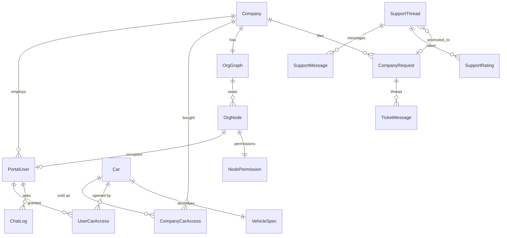

<!-- i18n-source: 34-data-model-reference.md sha256:1982a22d8b4c -->

# ۳۴ — مرجع مدل داده (موجودیت‌ها، روابط، چرخهٔ عمر، الگوهای دسترسی)

همراه روایی سند ماشینی [generated/schema.md](../generated/schema.md) (همهٔ مدل‌های `api/models.py`، `api/support_chat/models.py` و `api/notifications/models.py`: هر فیلد، رابطه، ایندکس و محدودیتی که در کد اعلام شده، به‌علاوهٔ نمودار ER؛ بازتولید با `python3 ops/governance/gen_schema.py` و بررسی در CI). لایه‌های ذخیره‌سازی بیرون از Django (PostgreSQL با نام `kgkg_vec`، کاتالوگ‌های SQLite قطعات، ایندکس RAG) در [23-data-layer.md](../23-data-layer.md) و [03-data-model.md](../03-data-model.md) آمده‌اند. نسخهٔ `origin/work` در `07f3ab5` **[C]**؛ پایگاه داده زنده بررسی نشده، پس محتوای جدول‌ها، تعداد ردیف‌ها، ایندکس‌های واقعی و وضعیت migrationهای اعمال‌شده **[U]** است. نسخهٔ انگلیسی: [../34-data-model-reference.md](../34-data-model-reference.md).

## ۳۴٫۱ لایه‌های ذخیره‌سازی در یک نگاه

| لایه | موتور و پایگاه | محتوا | شرح معتبر |
|---|---|---|---|
| پرتال | PostgreSQL 16 با نام `kgkg` (در توسعه فایل SQLite) | همهٔ مدل‌های Django زیر | همین سند، `generated/schema.md` |
| محتوای خودرو (خودروهای دارای دفترچه) | PostgreSQL با نام `kgkg_vec`، schema با نام `car_<md5 نام فایل>` برای هر خودرو، رجیستری `public.car_dbs` | درخت گره‌ها، HTML، جدول‌های DTC و علامت | [23](../23-data-layer.md)، [15](../15-vehicle-schema.md) |
| محتوای خودرو (فقط‌قطعات) | یک فایل SQLite فقط‌خواندنی برای هر خودرو زیر `Database_warehouse/_parts/` | کاتالوگ قطعات | [16](../16-parts-catalog.md) |
| RAG مشتق‌شده | `_rag/index.rag.db` (SQLite، FTS5، sqlite-vec)، `_rag/diag/*.db`، آینهٔ اختیاری pgvector | blob، رخداد، بردار، گراف، sidecarهای عیب‌یابی | [30](30-ai-assistant-deep-dive.md) |
| sidecar داده‌های کاربر | `_rag/feedback.db` (SQLite) | لاگ پرسش‌های دستیار، امتیازها، کلیک‌ها، pinهای کارشناسی | [30](30-ai-assistant-deep-dive.md) بخش ۳۰٫۱۰ |
| فایل‌ها | `static_warehouse/<car>/` تصاویر، قرنطینه، گزارش‌ها | رسانه | [25](../25-ops-inventory.md) |

مدل `Car` پل ارتباطی است: `db_table = 'main_db'`، یک ردیف برای هر خودرو که کلید نام فایل آن مخزن محتوای آن خودرو را (فایل SQLite یا schema در PostgreSQL) پیدا می‌کند. PostgreSQL و SQLite در اینجا جایگزین یکدیگر نیستند: `cardb_pg.py` فقط زیرمجموعه‌ای از SQL را ترجمه می‌کند و `adopt()` فایل SQLite را پس از بارگذاری حذف می‌کند ([23](../23-data-layer.md)).

## ۳۴٫۲ گروه‌های موجودیت

### کاتالوگ و استحقاق
`Car` (ردیف خودرو) ← `CompanyCarAccess` (آنچه یک شرکت خریده: یکتایی `(company, car)` همراه لایه‌های سند) ← `UserCarAccess` (اعطای سطح کاربر درون خرید شرکت: یکتایی `(user, car)`). `VehicleSpec` رابطهٔ یک‌به‌یک با `Car` دارد (مشخصات ساختاریافته به شکل schema.org). `PurchaseRequest` درخواست خرید بازدیدکننده پیش از داشتن حساب است.

### مستأجری و هویت
`Company` (شخص حقوقی؛ برچسب‌های `CompanyRole` با یکتایی `(company, value)`)، `PortalUser` (صندلی شرکت؛ ارجاع به خودش با `reports_to` و `invited_by`)، `PlatformAdmin` (کارکنان فروشنده، جدا از صندلی‌ها). نشست‌ها: `SessionTokenBase` انتزاعی ← `AuthToken` (پرتال) و `AdminAuthToken` (ادمین)، توکن‌های مات هش‌شده. عامل دوم: `OtpChallenge`، `AdminOtpChallenge`، `OtpEvent` (دفتر ارسال/کد غلط، ایندکس `(user, kind, at)`). دستگاه‌ها: `KnownDevice` (یکتایی `(user, device_hash)`)، `RetiredDevice`. دعوت‌ها: `InviteToken` (یک‌بارمصرف و منقضی‌شونده)، `NodeInvite` (وابسته به یک صندلی خالی).

### گراف سازمانی و تفویض
`OrgGraph` (یکی برای هر شرکت) ← `OrgNode` (صندلی؛ درخت `parent`؛ متصدی یک‌به‌یک `PortalUser`؛ محدودیت پایگاه `one_root_per_graph` — حداکثر یک ریشه در هر گراف) ← `NodePermission` (مجموعهٔ مجوز تعیین‌شده توسط ریشه، که به مجوزهای مؤثر کامپایل می‌شود). قاعدهٔ تفویض: مدیر فقط دسترسی‌ای را می‌تواند بدهد که خودش دارد ([06](../06-permissions-rbac.md)).

### درخواست‌ها و تیکت‌ها (مشتریان واردشده)
`CompanyRequest` (ثبت‌شده توسط مدیر، واگذارشده به یک `PlatformAdmin`؛ ایندکس‌های `(company,status)` و `(status,created_at)`) ← `TicketMessage` (نویسنده کاربر یا ادمین است) و `TicketRead` (نشانگر خوانده‌شدن؛ یکتا به ازای `(request,user)` و `(request,admin)`؛ `CheckConstraint` دقیقاً یکی از کاربر/ادمین را الزامی می‌کند).

### چت پشتیبانی ناشناس
`SupportThread` (کلید اصلی UUID؛ `token_hash` یکتا؛ ماشین وضعیت؛ `promoted_request` اختیاری به `CompanyRequest`)، `SupportMessage`، `SupportRating`، `SupportPresence`. عمداً از تیکت‌ها جدا نگه داشته شده تا خطا در نقاط پایانی ناشناس نتواند داده شرکتی را فاش کند ([35](35-support-system.md)). ردیف‌های تحویل اعلان در `api/notifications/models.py` (`NotificationOutbox`) هستند.

### پایگاه دانش و بازخورد
`KnowledgeArticle` ← `KnowledgeRevision` (یکتایی `(article, version)`)، `KbSearchLog`، `Feedback` (بازخورد محصول بدون درخواست)، `FeatureFlag` (A/B و عرضهٔ تدریجی).

### لاگ‌های دستیار و تحلیل
`ChatLog` (یک مبادلهٔ دستیار: پرسش، پاسخ نهایی، حالت، پرچم‌ها، توکن‌ها، هزینه؛ ایندکس‌های `(company,created_at)` و `(user,created_at)`)، `SearchLog` (شناسهٔ ساده، **بدون FK** تا تحلیل‌ها با حذف‌ها از بین نروند)، `ActivityLog` (رویدادهای استفاده؛ ایندکس‌های `(user,created_at)`، `(category,created_at)`، `(created_at)`، `(user,action)`)، `TrafficStat` (تجمیع هر نقطهٔ پایانی، یکتایی `(bucket,endpoint,method)`)، `VisitorSeen` (یکتایی `(day, ip_hash)`: بازدیدکنندگان یکتای روزانهٔ دقیق با هش نمک‌دار IP).

### عملیات و ممیزی
`AuditLog` (فقط‌افزودنی؛ `ordering -id`؛ ایندکس‌ها روی بازیگر، شرکت، نتیجه و ip همراه `created_at`)، `Event` (گذرگاه SSE؛ ایندکس‌های `(audience,id)` و `(company_id,id)`)، `SystemAlert`، `SystemState` (مخزن کلید ← JSON برای singletonهای مشترک بین workerها)، `ProcessingJob`، `ZipPackage` (صف parse)، `PipelineSettings` (ردیف singleton با id=1)، `DataQualityRun`، `NotificationLog` (دفتر dedupe پیامک).

## ۳۴٫۳ نمای کلی ارتباط موجودیت‌ها (هسته)

مجموعهٔ کامل روابط اعلام‌شده (هر کلید خارجی) در [generated/schema.md](../generated/schema.md) است.

## ۳۴٫۴ چرخهٔ عمر

- **راه‌اندازی شرکت:** `PurchaseRequest` ← تأیید ادمین ← `Company` + `CompanyCarAccess` + اولین `PortalUser` (دعوت یا ساخت مستقیم) ← `UserCarAccess` برای هر صندلی ([00-srs.md](../00-srs.md) FR-01/02).
- **نشست:** ورود (گذرواژه) ← `OtpChallenge` ← تأیید ← `AuthToken` (هش‌شده، قابل ابطال سمت سرور؛ یک نشست زنده برای هر حساب) ← خروج توکن را حذف/ابطال می‌کند ([26](../26-auth-and-sessions.md)).
- **thread پشتیبانی:** `open` ⇄ `waiting_staff` ⇄ `waiting_customer` ← `closed` (قابل بازگشایی تا `KG_SUPPORT_REOPEN_DAYS` با پیش‌فرض ۱۴) یا `spam`؛ ارتقا به تیکت `promoted_request` را تنظیم می‌کند ([35](35-support-system.md)).
- **ورود محتوا:** کشف `ZipPackage` ← مراحل `ProcessingJob` ← ساخت/بارگذاری مخزن محتوای خودرو ← همگام‌سازی ردیف `Car` (`sync_car_catalog`) ← ساخت ایندکس RAG و sidecarهای diag ← ممیزی `DataQualityRun`.
- **رویدادها:** ردیف‌های `Event` فقط‌افزودنی‌اند؛ مصرف‌کننده‌ها بر اساس id دنبال می‌کنند؛ ردیف‌های قدیمی با نگهداری حذف می‌شوند (نگهداشت راستی‌آزمایی نشده **[U]**).

## ۳۴٫۵ قیدها و قواعد یکپارچگی که پایگاه داده اعمال می‌کند [C]

| قاعده | محل |
|---|---|
| حداکثر یک صندلی ریشه در هر گراف سازمانی | `OrgNode` ‏`UniqueConstraint(graph) where is_root` (با نام `one_root_per_graph`) |
| یک ردیف خرید برای هر (شرکت، خودرو)؛ یک اعطا برای هر (کاربر، خودرو) | `unique_together` روی `CompanyCarAccess`، `UserCarAccess` |
| یک امتیاز برای هر بسته‌شدن thread | `supportrating_one_per_closure` |
| تلاش مجدد کلاینت پیام پشتیبانی را تکراری نمی‌کند | `supportmessage_client_id_once_per_thread` (برای `client_id` غیرخالی) |
| نشانگر خوانده‌شدن تیکت دقیقاً به یکی از کاربر/ادمین تعلق دارد | `CheckConstraint` در `TicketRead` + دو قید یکتایی |
| شمارهٔ ویرایش برای هر مقاله یکتاست | `KnowledgeRevision` با یکتایی `(article, version)` |
| ستون‌های NOT NULL چت پشتیبانی `db_default` دارند | ایمنی rollback: نسخهٔ قبلی همچنان می‌تواند درج کند |

migrationها فقط افزایشی‌اند (`ops/deploy/check_migrations.py`)؛ دیپلوی هرگز migration را برنمی‌گرداند.

## ۳۴٫۶ الگوهای دسترسی و نکات کارایی

- مسیرهای خواندن پرتراکم از ایندکس‌های اعلام‌شده روی `ActivityLog`، `AuditLog`، `Event`، `ChatLog`، `SearchLog` و `SupportMessage (thread,id)` استفاده می‌کنند. breadcrumb برای هر صفحه یک CTE بازگشتی می‌گیرد.
- محتوای خودرو از طریق `api/cardb.py` (`connect()` ← فایل SQLite یا `PgCarConn`) خوانده می‌شود، نه ORM؛ کلیدها نام فایل‌اند.
- نوشتن در جدول‌های استفاده/لاگ دسته‌ای (flush مربوط به `TrafficStat`) یا فقط‌افزودنی است؛ `SearchLog` و `Event` از FK پرهیز می‌کنند تا نوشتن ارزان و در برابر حذف مقاوم باشد.
- تجمیع‌های سنگین در برنامه محاسبه می‌شوند (`reporting.py`، `insights.py`)، نه view ذخیره‌شده.

## ۳۴٫۷ پشتیبان‌گیری، نگهداشت و بازیابی (وضعیت دانش)

دیپلوی پیش از migration از پایگاه داده پشتیبان می‌گیرد (`deploy.sh`، در `/opt/KGKG_release/db-backups`) و یک snapshot ساعتی خارج از میزبان وجود دارد **[D]**، اما پوشش راستی‌آزمایی‌شده فقط `kgkg` است؛ برای `kgkg_vec`، فایل‌های SQLite قطعات و تصاویر استاتیک **پشتیبان راستی‌آزمایی‌شده‌ای وجود ندارد** (ریسک R1، [27](../27-open-risks-and-decisions.md)). نگهداشت چت پشتیبانی پیکربندی شده اما حذف مستلزم کلید صریح است ([35](35-support-system.md) بخش ۳۵٫۸). تا بسته‌شدن R1 فرض نکنید هیچ جدولی قابل بازیابی است.

## ۳۴٫۸ چگونه مدل را تغییر دهیم

۱. `models.py` را ویرایش کنید؛ یک migration افزایشی اضافه کنید (حذف/تغییر نام ستون زنده ممنوع؛ برای ستون NOT NULL جدید `db_default` بگذارید).
۲. `python3 ops/governance/gen_schema.py` را اجرا و `docs/generated/schema.md` را کامیت کنید؛ اگر گروه یا قیدی تغییر کرده روایت بالا را به‌روز کنید.
۳. `python manage.py makemigrations --check --dry-run` و مجموعهٔ تست بک‌اند باید موفق شوند؛ اگر شکل API تغییر کرد `docs/openapi.yaml` را به‌روز کنید.

