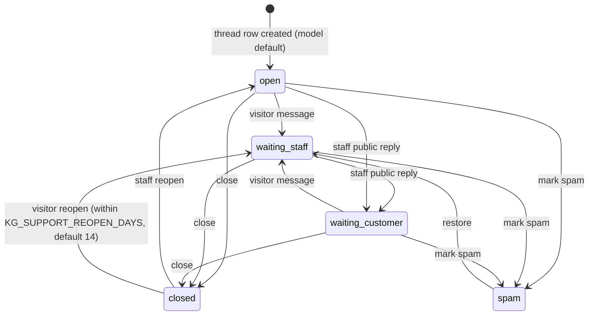

<!-- i18n-source: 35-support-system.md sha256:050061165909 -->

# ۳۵ — سامانهٔ پشتیبانی مشتری (چت بازدیدکننده، صندوق ورودی کارکنان، تیکت، اعلان‌ها)

مرجع عمیق آنچه کد در `origin/work` نسخهٔ `07f3ab5` پیاده کرده است **[C]**. [22-support-chat.md](../22-support-chat.md) (نقشهٔ کد و ویژگی‌های امنیتی) و [24-integrations.md](../24-integrations.md) را گسترش می‌دهد. اینکه هر قابلیت در تولید روشن است یا نه **[U]** است: میزبان بررسی نشد. نسخهٔ انگلیسی: [../35-support-system.md](../35-support-system.md). سوابق طراحی (تاریخ‌دار، تاریخی): `docs/superpowers/specs/2026-11-02-customer-communication-design.md` و `2026-11-03-phase3-migration-and-rbac-design.md`.

## ۳۵٫۱ دو کانال، عمداً جدا

| کانال | چه کسی | جدول‌ها | احراز هویت |
|---|---|---|---|
| **تیکت‌ها** | مدیران شرکت و ادمین‌های پلتفرم که وارد شده‌اند | `CompanyRequest`، `TicketMessage`، `TicketRead` | توکن bearer پرتال/ادمین |
| **چت پشتیبانی** | بازدیدکنندگان ناشناس (پیش از داشتن حساب) و کارکنان | `SupportThread`، `SupportMessage`، `SupportRating`، `SupportPresence` | بازدیدکننده: توکن bearer هر thread؛ کارکنان: نشست ادمین |

بنابراین خطا در نقاط پایانی ناشناس نمی‌تواند داده تیکت‌های شرکتی را فاش کند. یک thread را می‌توان به تیکت *ارتقا* داد (`SupportThread.promoted_request`)؛ جدول‌های تیکت چیزی دربارهٔ thread نمی‌دانند.

## ۳۵٫۲ وضعیت قابلیت‌ها (چه هست و چه خاموش است)

| قابلیت | وضعیت | کلید / مبنا |
|---|---|---|
| ویجت و نقاط پایانی چت بازدیدکننده | **پیاده‌شده؛ خاموش مگر فعال شود** | `KG_SUPPORT_CHAT_ENABLED=1` فقط threadهای *جدید* را کنترل می‌کند؛ با خاموش‌بودن، threadهای موجود و پاسخ کارکنان کار می‌کنند |
| صندوق ورودی کارکنان (فهرست، جزئیات، پاسخ، بستن، بازگشایی، seen، واگذاری، اولویت، intent، spam، restore) | پیاده‌شده | نشست ادمین؛ حالت RBAC زیر |
| حضور («آیا کسی آنلاین است») | پیاده‌شده | پنجرهٔ `KG_SUPPORT_PRESENCE_WINDOW_S` (۶۰ ثانیه) |
| دسترسی نقش‌محور برای پشتیبانی | **پیاده‌شده، به‌صورت پیش‌فرض خاموش** | `KG_SUPPORT_RBAC` برابر `off` (پیش‌فرض) / `audit` / `enforce` (مقدار ناشناخته ⇐ `enforce`) |
| صندوق خروجی اعلان (پیامک، ایمیل) | پیاده‌شده؛ **کانال‌ها به‌صورت پیش‌فرض خاموش** | `KG_NOTIFY_SMS`، `KG_NOTIFY_EMAIL` برابر `off`/`dry_run`/`live`؛ غلط تایپی ⇐ `off` |
| وعدهٔ زمان پاسخ به مشتریان | **ارائه نمی‌شود** | `KG_SUPPORT_REPLY_TARGET_MINUTES` عمداً تنظیم نشده |
| اجرای نگهداشت (retention) | **فقط گزارش** | حذف نیازمند `KG_SUPPORT_RETENTION_ENABLED=1` **و** `purge_support_chat --apply` |
| خط زمانی رویداد thread | پیاده نشده | ردیابی با `AuditLog` (فقط شناسه‌ها) |
| E2E مرورگر برای چت | در CI تست می‌شود | job با نام `support-chat-e2e` (۲۱ تست در یادداشت قبلی) |
| فعال‌سازی در تولید | **[U]** | پیش‌نویس اعلان حریم خصوصی منتشر نشده؛ نگهداشت پشتیبان نامعلوم (R1/R5) |

## ۳۵٫۳ چرخهٔ عمر گفتگو

گذارها صریح‌اند و هر بستن/بازگشایی یک خط با نویسندهٔ سیستم می‌نویسد (`گفتگو بسته شد.` / `گفتگو دوباره باز شد.`) تا تاریخچه بی‌صدا وضعیتش را عوض نکند (`lifecycle.py`؛ فراخواننده‌ها قفل ردیف را نگه می‌دارند). بازگشایی `reopen_count` را افزایش می‌دهد؛ ثبت امتیاز رضایت (`SupportRating`) برای هر بسته‌شدن یک‌بار مجاز است (`closure = reopen_count`). نمودار با انتساب وضعیت‌ها در `views_public.py`، `views_admin.py` و `lifecycle.py` تطبیق داده شده است؛ پیام بازدیدکننده به thread با وضعیت spam رد می‌شود و restore به `waiting_staff` می‌رود. پیش از تغییر هر گذار آن فایل‌ها را دوباره بخوانید.

## ۳۵٫۴ API بازدیدکننده (ناشناس) [C] `support_chat/urls.py`

| مسیر | هدف |
|---|---|
| `GET api/support-chat/status/` | در دسترس‌بودن ویجت (فعال، حضور کارکنان، زمان پاسخ هدف) |
| `POST api/support-chat/threads/` | ایجاد (وقتی کلاینت توکن ۴۳‌نویسه‌ای خودش را بدهد idempotent است) |
| `GET/POST api/support-chat/threads/<id>/messages/` | poll / ارسال (`client_id` تلاش مجدد را امن می‌کند) |
| `POST …/contact/` | افزودن نام، تلفن، ایمیل (با اعتبارسنجی) |
| `POST …/reopen/`، `POST …/csat/` | بازگشایی thread خود؛ امتیازدهی به بسته‌شدن |

قواعد ورودی (`limits.py`): متن حداکثر ۲۰۰۰ نویسه، نویسه‌های کنترلی حذف، متن فقط‌نامرئی رد؛ intent یکی از {sales, demo, technical, other}؛ `source_page` بدون query و fragment و `referrer` فقط به شکل scheme://host/path ذخیره می‌شود (query می‌تواند داده شخصی حمل کند)؛ تلفن نرمال‌سازی می‌شود و باید ۱۰ تا ۱۵ رقم باشد؛ ایمیل با اسکن خطی (بدون backtracking در regex) از نظر شکل بررسی می‌شود.

## ۳۵٫۵ هویت، توکن‌ها و مدیریت نشست

توکن بازدیدکننده ۳۲ بایت تصادفی با base64 امن برای URL و بدون padding است (دقیقاً ۴۳ نویسه)؛ فقط SHA-256 آن ذخیره می‌شود (`SupportThread.token_hash`، یکتا)، پس نشت پایگاه داده گفتگوها را فاش نمی‌کند. کلاینت می‌تواند توکن خودش را بسازد تا ایجاد thread idempotent باشد. توکن اشتباه و thread ناموجود هر دو ۴۰۴ می‌دهند (`authorise` از `hmac.compare_digest` استفاده می‌کند)؛ توکن مخدوش پیش از هر query رد می‌شود. هویت بازدیدکننده فراتر از این گردآوری نمی‌شود: `ua_hash` یک هش است و فیلدهای تماس اختیاری‌اند.

## ۳۵٫۶ سمت کارکنان

نقاط پایانی زیر `api/admin/support-chat/…`: حضور و heartbeat؛ فهرست/جزئیات thread؛ `reply`، `close`، `reopen`، `seen`، `assign`، `priority`، `intent`، `spam`، `restore`. فیلد `staff_seen_at` یک نشانگر مشترک است (نه برای هر ادمین) که تیک «خوانده شد» بازدیدکننده و نقطهٔ نخوانده در صندوق ورودی را می‌راند. یادداشت‌های داخلی (`SupportMessage.internal`) هرگز برای بازدیدکننده سریالایز نمی‌شوند.

**RBAC** (`rbac.py`، نمای `permissions.py`): مجوزها `support.read, reply, take, assign, priority, intent, close, reopen, spam, reveal_contact, exclude, metrics, notify_health, availability, roles`. نقش‌ها و آنچه دارند:

| نقش | intentها | مجوزها (دامنه) |
|---|---|---|
| `support_agent` | technical، other | read/reply/take (مال خود یا بدون مسئول)؛ priority/intent/close/reopen/reveal_contact (مال خود)؛ availability |
| `sales_agent` | sales، demo | همان ماتریس agent |
| `support_lead` | همه | همه به‌جز `roles`، روی همهٔ threadها |
| `support_auditor` | همه | read، metrics، notify_health (فقط‌خواندنی) |
| `support_owner` | همه | مجموعهٔ lead به‌علاوهٔ `roles` |

حالت‌ها: `off` (هر ادمین *شخص* واردشده هرکاری را می‌تواند — رفتار امروز)، `audit` (همان دسترسی، ردیف ممیزی فقط‌شناسه برای ردهایی که رخ می‌داد)، `enforce` (پیش‌فرض رد؛ اگر هیچ مالک فعالی حل نشود نقاط پایانی پشتیبانی ۴۰۳ با `rbac_no_owner` می‌دهند؛ بازیابی با `KG_SUPPORT_OWNERS`، دستور `support_roles` یا `KG_SUPPORT_RBAC=off`). threadهای خارج از دامنه ۴۰۴ می‌دهند (بدون oracle وجود). توکن حلقوی `KG_ADMIN_TOKEN` هرگز یک شخص نیست و مجوز پشتیبانی ندارد. ذخیرهٔ نقش فراتر از `KG_SUPPORT_OWNERS` (جدول `SupportStaffRole`) به یک migration بعدی وابسته است (اعمال‌شدنش **[U]** است).

## ۳۵٫۷ رفتار بی‌درنگ، محدودیت نرخ و بار

- **به‌روزرسانی‌ها:** رویدادهای سرور `support_chat.message` و `support_chat.updated` روی گذرگاه SSE مشترک می‌روند (`events.emit`)؛ کانکتور فرانت‌اند از SSE با جایگزین polling و watchdog توقف ۴۵ ثانیه‌ای استفاده می‌کند (`kg_frontend/src/utils/eventStreamConnector.js`، [09](../09-realtime-sse.md)). نقطهٔ poll بازدیدکننده ۳۰ بار در دقیقه برای هر thread محدود است (polling هر ۳ ثانیه = ۲۰ بار در دقیقه).
- **محدودیت‌ها** (`config.py`، با `KG_SC_<NAME>="N/seconds"` قابل تغییر، `0/0` غیرفعال): poll ‏۳۰ در ۶۰ ثانیه برای هر thread؛ send ‏۲۰ در ۶۰ ثانیه؛ send_hour ‏۳۰ در ۳۶۰۰؛ contact ‏۱۰ در ۶۰؛ csat ‏۵ در ۶۰؛ reopen ‏۵ در ۶۰؛ create ‏۲۰ در ۶۰۰ ثانیه برای هر IP؛ بررسی‌های ناموفق توکن ۳۰ در ۶۰ ثانیه برای هر IP؛ status ‏۶۰ در ۶۰ برای هر IP. کلید، توکن thread است نه IP، پس NATهای مشترک سهم یکدیگر را نمی‌خورند. محدودکنندهٔ poll به‌ازای هر worker در gunicorn و درون‌فرایندی است (سهم مؤثر تا تعداد worker × مقدار)؛ بقیهٔ محدودیت‌ها از مخزن مشترک `api/ratelimit.py` استفاده می‌کنند. خطای محدودکننده هرگز چت را از کار نمی‌اندازد (fail open). nginx یک منطقهٔ `kg_chat` (۶۰ درخواست در دقیقه) هم اضافه می‌کند.
- **آزمون بار:** `qa/k6/support_chat_poll.js` (پیش‌فرض ۱۰۰ کاربر مجازی / ۶۰ ثانیه) هزینهٔ polling را می‌سنجد ([32](32-testing-and-qa.md) بخش ۳۲٫۶)؛ نتیجهٔ ثبت‌شده‌ای کامیت نشده **[U]**.

## ۳۵٫۸ حریم خصوصی و نگهداشت

ذخیره می‌شود: متن پیام‌ها، نام/تلفن/ایمیل اختیاری، صفحهٔ مبدأ و referrer (بدون query)، هش UA. نگهداشت **پیشنهادی است، نه اجرا‌شده**: threadهای بدون اطلاعات تماس ۳۰ روز، با اطلاعات تماس ۱۸۰، spam ‏۷، ارتقایافته ۳۰ (`KG_SUPPORT_RETENTION_*_DAYS`)؛ دستور `manage.py purge_support_chat` به‌طور پیش‌فرض فقط گزارش می‌دهد و تنها با `KG_SUPPORT_RETENTION_ENABLED=1` و `--apply` حذف می‌کند؛ حذف thread پیام‌ها و امتیازهایش را هم حذف می‌کند؛ **پشتیبان‌ها دست‌نخورده می‌مانند**. نسخه‌های staging/QA داده تماس چت پشتیبانی و referrer را ماسک می‌کنند (`sanitize_staging_db.py`، در خطا بسته می‌شود). اعلان حریم خصوصی هنوز پیش‌نویس منتشرنشده است.

## ۳۵٫۹ صندوق خروجی ارتباط با مشتری (`api/notifications/`)

کد درخواست هرگز با ارائه‌دهنده صحبت نمی‌کند: `service.enqueue(...)` ردیفی در `NotificationOutbox` همان تراکنش رویداد می‌نویسد، پس خرابی نمی‌تواند اعلانی را گم کند و پیامِ rollback‌شده اعلانی باقی نمی‌گذارد. یک worker (`manage.py process_outbox`؛ واحد `ops/outbox/kgkg-outbox.service` + `.timer`) ردیف‌ها را می‌فرستد، با backoff دوباره تلاش می‌کند و به‌صورت قابل‌مشاهده `dead` علامت می‌زند.

- وضعیت‌ها: `queued, sending, sent (پذیرفته‌شده توسط ارائه‌دهنده، نه اثبات تحویل), failed (تلاش مجدد در next_attempt_at), dead, suppressed (کانال هنگام نوشتن خاموش بود), dry_run`.
- `dedupe_key` وقتی مقدار دارد یکتاست؛ فراخواننده‌ها با پنجرهٔ زمانی (`window_key`) آن را دسته‌بندی می‌کنند تا انفجار رویدادها یک اعلان شود.
- کانال‌ها و حالت‌ها: `KG_NOTIFY_SMS`، `KG_NOTIFY_EMAIL` برابر `off` (پیش‌فرض؛ ردیف‌ها `suppressed` نوشته می‌شوند)، `dry_run` (تولید متن و لاگ)، `live`.
- ارائه‌دهندگان (`providers.py`): `send` هرگز استثنا نمی‌اندازد؛ پیامک از Melipayamak (وقتی `Value > 1000` برگردد پذیرفته‌شده است؛ اپراتور نام‌ها/عددهای نقطه‌دار را لینک می‌پندارد پس متن‌ها از آن‌ها پرهیز می‌کنند؛ پاورقی لغو `لغو11`)، ایمیل از SMTP (`EMAIL_*`، `KG_NOTIFY_FROM_EMAIL`). رسید تحویل و bounce **مشاهده نمی‌شود**.
- سلامت: `manage.py support_health` نشان می‌دهد چند بازدیدکننده منتظر پاسخ انسانی هستند و چه مدت (پیش‌فرض هشدار ۳۰۰ ثانیه، بحرانی ۹۰۰؛ فقط‌خواندنی، عمداً به هشدارها متصل نشده).

## ۳۵٫۱۰ روال‌های عملیاتی

۱. پیش از فعال‌سازی عمومی: `support-chat-e2e` سبز؛ اعلان حریم خصوصی تأیید؛ نگهداشت/پشتیبان معلوم (R1/R5)؛ حالت `KG_SUPPORT_RBAC` و مالکان اولیه (`KG_SUPPORT_OWNERS`) تعیین شود.
۲. فعال‌سازی: `KG_SUPPORT_CHAT_ENABLED=1` و ری‌استارت (`deploy.sh --reload`). غیرفعال‌سازی: مقدار را بردارید؛ threadهای موجود ادامه می‌دهند.
۳. کارکنان: اعلام حضور (heartbeat)، تفکیک بر اساس intent، واگذاری، پاسخ؛ پس از اتمام بستن؛ علامت spam؛ ارتقا به تیکت وقتی بازدیدکننده مشتری است.
۴. پایش: `support_health`، `admin/support/metrics/` (`support_metrics.py`)، SLA (`sla.py`)، قواعد `_qa` و هشدار؛ رانبوک R10 در [20-runbooks.md](../20-runbooks.md).
۵. غیرفعال‌سازی فوری یک کانال: `KG_NOTIFY_*` مربوط را روی `off` بگذارید.

## ۳۵٫۱۱ تست‌ها

`api/support_chat/test_*.py` (security sweep، RBAC و API، lifecycle، throttling، tokens، privacy، purge، presence، staff actions، concurrency، load، benchmark، inbox API، health)، `api/notifications/test_*.py` (command، models، privacy و concurrency، providers، service، worker)، فرانت‌اند `support.test.mjs`/`desk.test.mjs`، و Playwright ‏`support-chat.spec.js` و `support.spec.js`. درصد پوشش اینجا ثبت نشده است ([32](32-testing-and-qa.md) بخش ۳۲٫۲).

## ۳۵٫۱۲ شکاف‌های شناخته‌شده

نبودن خط زمانی رویداد thread؛ تأییدنشدن دوره‌های نگهداشت و غیرفعال‌بودن purge؛ تنظیم‌نشدن وعدهٔ زمان پاسخ؛ مشاهده‌نشدن رسید تحویل؛ نامعلوم‌بودن وضعیت فعال‌سازی در تولید و وضعیت migration مربوط به `SupportStaffRole`؛ محدودکنندهٔ poll به‌ازای هر worker؛ اعلان حریم خصوصی منتشرنشده.

مشاهدهٔ تولید (۲۰۲۶-۱۱-۰۴، فقط‌خواندنی، کامیت `8a380f6`): مهاجرت `0041_support_chat_core` اعمال شده، نقطهٔ وضعیت عمومی `enabled=false` می‌دهد، هیچ متغیر `KG_SUPPORT_*` یا `KG_NOTIFY_*` تنظیم نشده، جدول‌های چت و صندوق خروجی ۰ ردیف دارند و `kgkg-outbox.timer` نصب نیست. بنابراین وضعیت فعال‌سازی اکنون **مشخص است: مستقر، غیرفعال، بدون استفاده** ([۳۸](38-implementation-status-matrix.md) بخش ۳۸٫۴)؛ اجبار `SupportStaffRole` خاموش است (`KG_SUPPORT_RBAC` تنظیم‌نشده).

