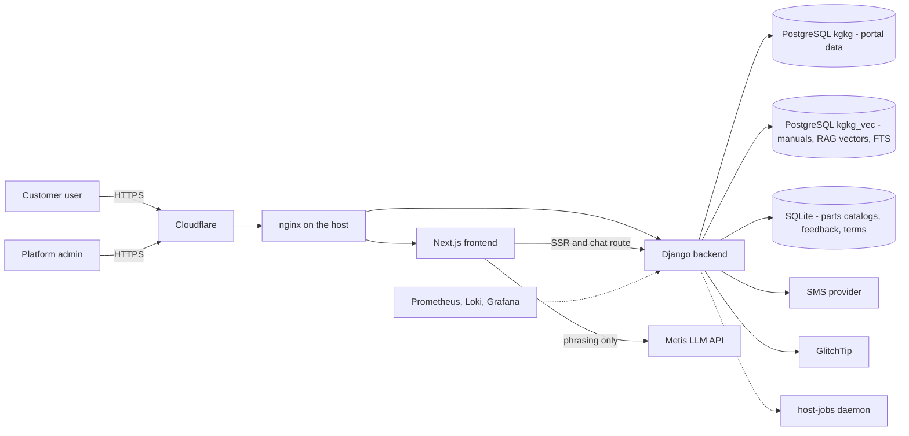
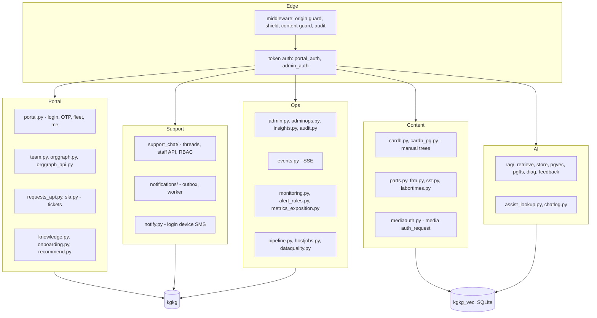
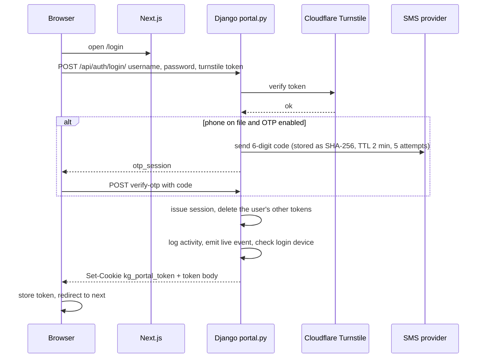
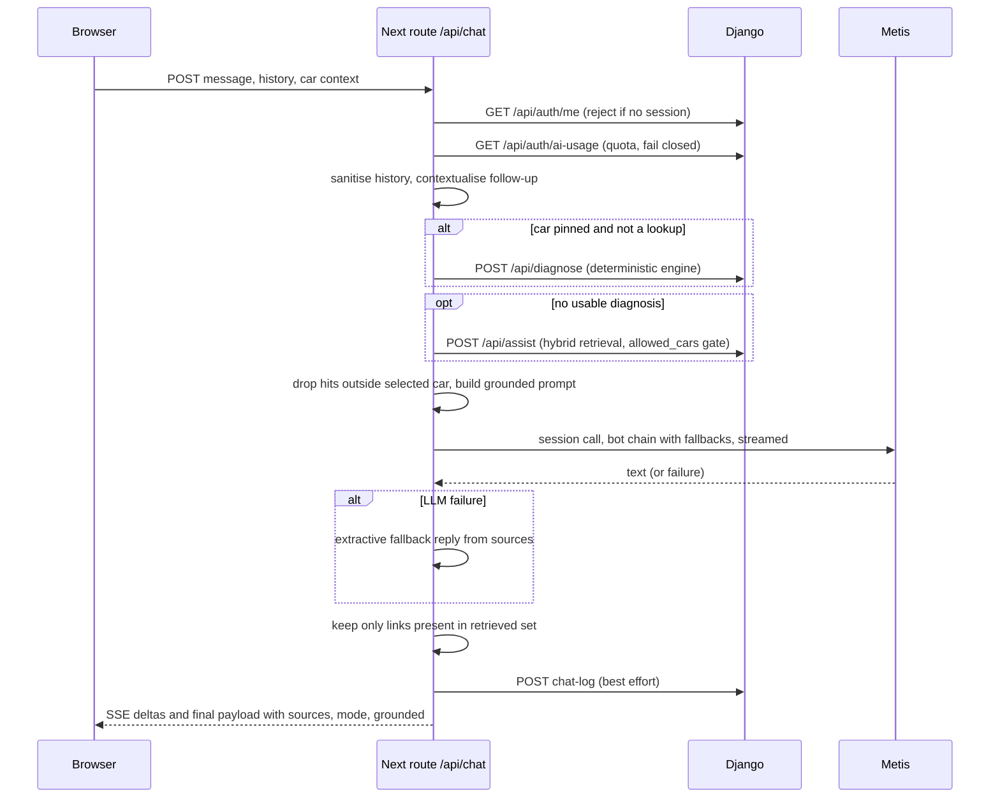
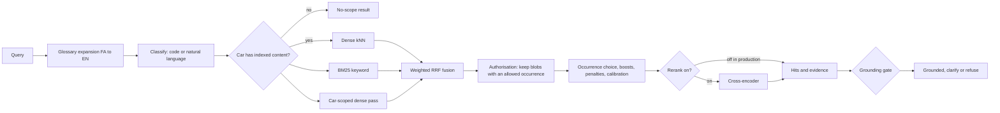
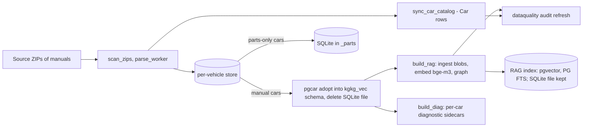
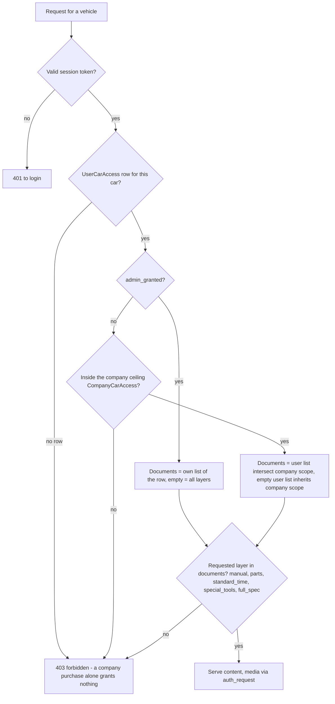
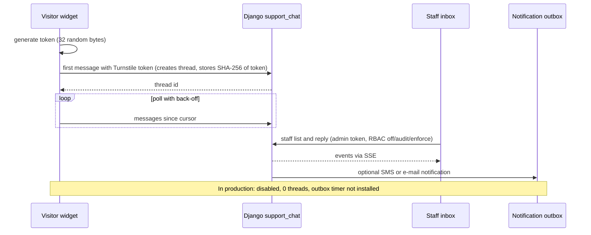
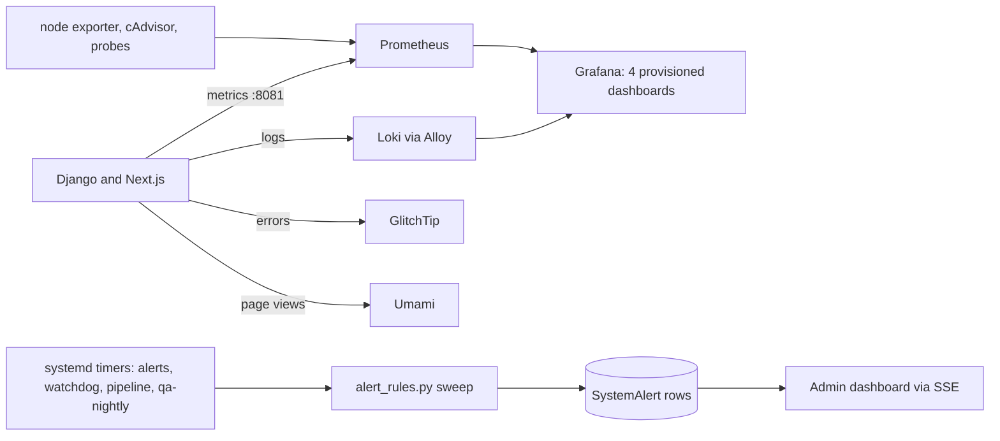
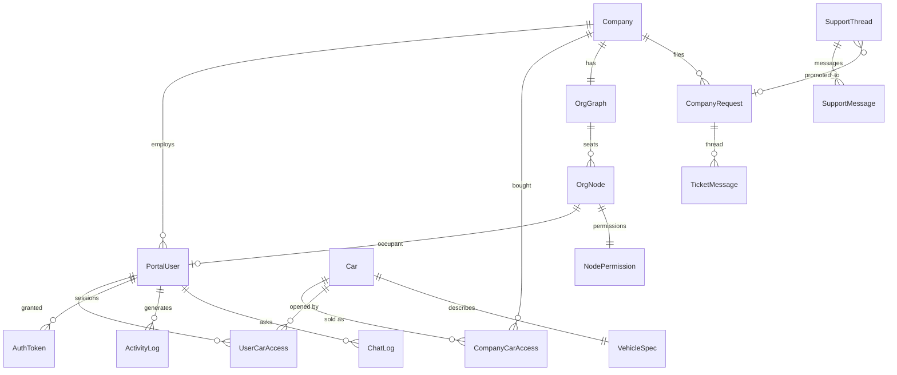

<!-- i18n-source: 43-architecture-diagrams.md sha256:8fe49e396f2c -->

# ۴۳ — نمودارهای معماری و جریان داده

یک مرجع واحد برای نمودارها که از پیاده‌سازی استخراج شده‌اند. نسخهٔ انگلیسی: [../43-architecture-diagrams.md](../43-architecture-diagrams.md). هر نمودار سند و کدی را که از آن آمده نام می‌برد؛ وضعیت تولید مطابق مشاهدهٔ ۲۰۲۶-۱۱-۰۴ است ([۳۸](38-implementation-status-matrix.md)). نمودار کامل موجودیت-رابطهٔ ۴۹ مدل تولیدشده است و نمی‌تواند از کد جدا شود: [generated/schema.md](../generated/schema.md). نمودارهایی که جای دیگری هستند کپی نشده‌اند: بافتار سیستم و کانتینرها [۳۳](33-system-design.md)، درخواست صفحهٔ دفترچه [۳۳](33-system-design.md)، حالت‌های رشتهٔ پشتیبانی [۳۵](35-support-system.md)، خط انتشار [۳۶](36-cicd-and-deployment.md). برچسب‌های داخل نمودارها عمداً انگلیسی‌اند (نام ماژول‌ها و جدول‌ها).

## ۴۳٫۱ بافتار سیستم (چه کسی با چه کسی)

منبع: [۳۳](33-system-design.md)، [۳۸ بخش‌های ۳۸٫۳ و ۳۸٫۵](38-implementation-status-matrix.md) (تولید بردارها و FTS را از `kgkg_vec` می‌خواند).

## ۴۳٫۲ نقشهٔ مؤلفه‌های بک‌اند

منبع: فهرست ماژول‌های `KG_backend/api/`، [۰۴](04-backend-reference.md)، [۳۳](33-system-design.md).

## ۴۳٫۳ ورود به پورتال با عامل دوم پیامکی

منبع: [۲۶ بخش ۲۶٫۲](26-auth-and-sessions.md)، `utils/api.jsx`، `app/login/page.tsx`.

## ۴۳٫۴ چرخهٔ درخواست دستیار

منبع: [۳۰ بخش‌های ۳۰٫۳ و ۳۰٫۷ تا ۳۰٫۸](30-ai-assistant-deep-dive.md)، `app/api/chat/route.js`.

## ۴۳٫۵ خط بازیابی (درون `/api/assist`)

منبع: [۳۰ بخش ۳۰٫۵](30-ai-assistant-deep-dive.md). ذخیرهٔ تولید: pgvector و جست‌وجوی متنی PostgreSQL؛ بازرتبه‌بند خاموش ([۳۸](38-implementation-status-matrix.md)).

## ۴۳٫۶ جریان دریافت و پردازش محتوا

منبع: [۱۱ بخش ۱۱٫۶](11-operations-deployment.md)، [۲۳ بخش ۲۳٫۲](23-data-layer.md)، [۳۰ بخش ۳۰٫۴](30-ai-assistant-deep-dive.md)، `api/pipeline.py`، `management/commands/run_pipeline.py`. مراحل افزایشی و ازسرگیری‌پذیرند؛ شکست یک مرحله مراحل امنِ بعدی را متوقف نمی‌کند.

## ۴۳٫۷ تعیین دسترسی (چه کسی کدام خودرو را باز می‌کند)

منبع: [۰۶ بخش‌های ۶٫۲ تا ۶٫۳](06-permissions-rbac.md)، `access.user_car_documents`؛ دسترسی جایگاه‌ها در org-graph این ردیف‌ها را تغذیه می‌کند ([۰۶ بخش ۶٫۶](06-permissions-rbac.md)).

## ۴۳٫۸ مسیر پیام چت پشتیبانی (قابلیت مستقر، در تولید غیرفعال)

منبع: [۲۲](22-support-chat.md)، [۳۵](35-support-system.md)، `src/support-chat/*`. حالت‌های رشته: [۳۵](35-support-system.md).

## ۴۳٫۹ جریان پایش و هشدار

منبع: [۲۵](25-ops-inventory.md)، [۳۱](31-ops-files-reference.md)، `api/monitoring.py`، `api/alert_rules.py`. محتوای داشبوردها بازرسی نشد ([۳۸](38-implementation-status-matrix.md)).

## ۴۳٫۱۰ مدل داده دامنه (زیرمجموعهٔ اصلی؛ نمودار کامل در schema تولیدشده)

منبع: [۳۴](34-data-model-reference.md)، [generated/schema.md](../generated/schema.md) (مرجع قطعی هر کلید خارجی).

## ۴۳٫۱۱ جریان انتشار و استقرار

نمودار خط لوله را در [۳۶](36-cicd-and-deployment.md) ببینید (PR ← CI ← stage با کلید CI ← smoke ← **انسان با `kgkg-promote` ارتقا می‌دهد** ← جایگزینی بدون وقفه با بازگشت خودکار) و نمودار کانتینر/میزبان را در [۳۳](33-system-design.md). ارتقا هرگز خودکار نیست.

