# Generated schema (structure as declared in Django models)

Generated by `ops/governance/gen_schema.py` from the three model files listed in SOURCES (api, support_chat, notifications).
Do not edit. This is the declared structure, **not** a dump of production: the live database was not inspected [U].
Narrative, lifecycle and the storage tiers outside Django: [../34-data-model-reference.md](../34-data-model-reference.md), [../23-data-layer.md](../23-data-layer.md).

49 models.

## Entity-relationship diagram (declared foreign keys)

```mermaid
erDiagram
    CompanyRole }o--|| Company : "company"
    CompanyCarAccess }o--|| Company : "company"
    CompanyCarAccess }o--|| Car : "car"
    PortalUser }o--|| Company : "company"
    PortalUser }o--|| PortalUser : "reports_to"
    PortalUser }o--|| PortalUser : "invited_by"
    UserCarAccess }o--|| PortalUser : "user"
    UserCarAccess }o--|| Car : "car"
    AuthToken }o--|| PortalUser : "user"
    InviteToken }o--|| PortalUser : "user"
    ActivityLog }o--|| PortalUser : "user"
    ActivityLog }o--|| Car : "car"
    AdminAuthToken }o--|| PlatformAdmin : "admin"
    VehicleSpec ||--|| Car : "car"
    CompanyRequest }o--|| Company : "company"
    CompanyRequest }o--|| PortalUser : "created_by"
    CompanyRequest }o--|| Car : "car"
    CompanyRequest }o--|| PlatformAdmin : "assignee"
    TicketMessage }o--|| CompanyRequest : "request"
    TicketMessage }o--|| PortalUser : "author_user"
    TicketMessage }o--|| PlatformAdmin : "author_admin"
    OrgGraph ||--|| Company : "company"
    OrgGraph }o--|| PortalUser : "updated_by"
    OrgNode }o--|| OrgGraph : "graph"
    OrgNode }o--|| OrgNode : "parent"
    OrgNode ||--|| PortalUser : "occupant"
    NodePermission ||--|| OrgNode : "node"
    NodeInvite }o--|| OrgNode : "node"
    OtpChallenge }o--|| PortalUser : "user"
    OtpEvent }o--|| PortalUser : "user"
    AdminOtpChallenge }o--|| PlatformAdmin : "admin"
    KnownDevice }o--|| PortalUser : "user"
    NotificationLog }o--|| PortalUser : "user"
    RetiredDevice }o--|| PortalUser : "user"
    ChatLog }o--|| PortalUser : "user"
    ChatLog }o--|| Company : "company"
    TicketRead }o--|| CompanyRequest : "request"
    TicketRead }o--|| PortalUser : "user"
    TicketRead }o--|| PlatformAdmin : "admin"
    Feedback }o--|| PortalUser : "user"
    Feedback }o--|| Company : "company"
    KnowledgeArticle }o--|| PlatformAdmin : "owner"
    KnowledgeArticle }o--|| CompanyRequest : "source_request"
    KnowledgeRevision }o--|| KnowledgeArticle : "article"
    KnowledgeRevision }o--|| PlatformAdmin : "editor"
    KbSearchLog }o--|| PortalUser : "user"
    KbSearchLog }o--|| Company : "company"
    KbSearchLog }o--|| KnowledgeArticle : "deflected_article"
    SupportThread }o--|| PlatformAdmin : "assignee"
    SupportThread }o--|| CompanyRequest : "promoted_request"
    SupportRating }o--|| SupportThread : "thread"
    SupportMessage }o--|| SupportThread : "thread"
    SupportMessage }o--|| PlatformAdmin : "author_admin"
    SupportPresence ||--|| PlatformAdmin : "admin"
```

## Models

### ActivityLog

`KG_backend/api/models.py:474` — What users are doing — powers the usage report and analytics.

| Field | Type | Relation | Options |
|---|---|---|---|
| `user` | ForeignKey | PortalUser, on_delete=models.CASCADE, related_name='activities' |  |
| `action` | CharField |  | max_length=60 |
| `detail` | CharField |  | blank=True; max_length=400; default='' |
| `category` | CharField |  | blank=True; db_index=True; max_length=40; default='' |
| `car` | ForeignKey | Car, on_delete=models.SET_NULL, related_name='+' | null=True; blank=True |
| `node_title` | CharField |  | blank=True; max_length=300; default='' |
| `app_url` | CharField |  | blank=True; max_length=600; default='' |
| `created_at` | DateTimeField |  | auto_now_add=True |

Meta: `ordering = ['-created_at']`; `indexes = [models.Index(fields=['user', 'created_at']), models.Index(fields=['category', 'created_at']), models.Index(fields=['created_at']), models.Index(fields=['user', 'action'])]`

### AdminAuthToken

`KG_backend/api/models.py:533` — Session token issued after platform-admin username/password login.

| Field | Type | Relation | Options |
|---|---|---|---|
| `admin` | ForeignKey | PlatformAdmin, on_delete=models.CASCADE, related_name='tokens' |  |

Meta: `ordering = ['-created_at']`

### AdminOtpChallenge

`KG_backend/api/models.py:1318` — SMS second factor for platform-admin login (same scheme as OtpChallenge).

| Field | Type | Relation | Options |
|---|---|---|---|
| `key_hash` | CharField |  | unique=True; db_index=True; max_length=64 |
| `admin` | ForeignKey | PlatformAdmin, on_delete=models.CASCADE, related_name='otp_challenges' |  |
| `code_hash` | CharField |  | max_length=64 |
| `created_at` | DateTimeField |  | auto_now_add=True |
| `expires_at` | DateTimeField |  |  |
| `attempts` | PositiveSmallIntegerField |  | default=0 |

### AuditLog

`KG_backend/api/models.py:1439` — Append-only security/business audit trail (see api/audit.py).

| Field | Type | Relation | Options |
|---|---|---|---|
| `created_at` | DateTimeField |  | db_index=True; auto_now_add=True |
| `action` | CharField |  | db_index=True; max_length=80 |
| `actor_type` | CharField |  | max_length=12 |
| `actor_id` | IntegerField |  | null=True; blank=True |
| `actor_label` | CharField |  | blank=True; max_length=150; default='' |
| `company_id` | IntegerField |  | null=True; blank=True |
| `target_type` | CharField |  | blank=True; max_length=40; default='' |
| `target_id` | CharField |  | blank=True; max_length=64; default='' |
| `outcome` | CharField |  | max_length=10 |
| `status_code` | SmallIntegerField |  | null=True; blank=True |
| `ip` | CharField |  | blank=True; max_length=64; default='' |
| `user_agent` | CharField |  | blank=True; max_length=300; default='' |
| `method` | CharField |  | blank=True; max_length=8; default='' |
| `path` | CharField |  | blank=True; max_length=300; default='' |
| `detail` | JSONField |  | blank=True; default=dict |

Meta: `ordering = ['-id']`; `indexes = [models.Index(fields=['actor_type', 'actor_id', 'created_at']), models.Index(fields=['company_id', 'created_at']), models.Index(fields=['outcome', 'created_at']), models.Index(fields=['ip', 'created_at'])]`

### AuthToken

`KG_backend/api/models.py:407` — Opaque bearer token for portal users (simple, DB-backed sessions).

| Field | Type | Relation | Options |
|---|---|---|---|
| `user` | ForeignKey | PortalUser, on_delete=models.CASCADE, related_name='tokens' |  |

Meta: `ordering = ['-created_at']`

### Car

`KG_backend/api/models.py:31`

| Field | Type | Relation | Options |
|---|---|---|---|
| `brand_name` | TextField |  |  |
| `car_name` | TextField |  |  |
| `year` | IntegerField |  |  |
| `db_address` | TextField |  |  |

Meta: `db_table = 'main_db'`

### ChatLog

`KG_backend/api/models.py:1392` — One assistant exchange (question + final gated answer), written by the

| Field | Type | Relation | Options |
|---|---|---|---|
| `user` | ForeignKey | PortalUser, on_delete=models.CASCADE, related_name='chat_logs' |  |
| `company` | ForeignKey | Company, on_delete=models.CASCADE, related_name='chat_logs' |  |
| `session_id` | CharField |  | blank=True; db_index=True; max_length=100; default='' |
| `question` | TextField |  |  |
| `answer` | TextField |  | blank=True; default='' |
| `mode` | CharField |  | blank=True; max_length=20; default='' |
| `grounded` | BooleanField |  | default=False |
| `degraded` | BooleanField |  | default=False |
| `vehicle` | CharField |  | blank=True; max_length=200; default='' |
| `sources` | JSONField |  | blank=True; default=list |
| `latency_ms` | IntegerField |  | null=True; blank=True |
| `llm_latency_ms` | IntegerField |  | null=True; blank=True |
| `input_tokens` | IntegerField |  | null=True; blank=True |
| `output_tokens` | IntegerField |  | null=True; blank=True |
| `llm_cost` | FloatField |  | null=True; blank=True |
| `llm_usage` | JSONField |  | blank=True; default=dict |
| `client_key` | CharField |  | blank=True; db_index=True; max_length=40; default='' |
| `feedback` | SmallIntegerField |  | null=True; blank=True |
| `feedback_reason` | CharField |  | blank=True; max_length=20; default='' |
| `feedback_comment` | TextField |  | blank=True; default='' |
| `feedback_at` | DateTimeField |  | null=True; blank=True |
| `copied` | BooleanField |  | default=False |
| `source_clicks` | IntegerField |  | default=0 |
| `rephrased` | BooleanField |  | default=False |
| `flags` | JSONField |  | blank=True; default=dict |
| `created_at` | DateTimeField |  | auto_now_add=True |

Meta: `ordering = ['-created_at']`; `indexes = [models.Index(fields=['company', 'created_at']), models.Index(fields=['user', 'created_at'])]`

### Company

`KG_backend/api/models.py:107` — A legal entity that bought (or is evaluating) documentation access.

| Field | Type | Relation | Options |
|---|---|---|---|
| `name` | CharField |  | unique=True; max_length=200 |
| `department_label` | CharField |  | max_length=80; default='خدمات پس از فروش' |
| `reg_no` | CharField |  | blank=True; max_length=60; default='' |
| `landline` | CharField |  | blank=True; max_length=40; default='' |
| `mobile` | CharField |  | blank=True; max_length=40; default='' |
| `employees_count` | PositiveIntegerField |  | null=True; blank=True |
| `seats_count` | PositiveIntegerField |  | null=True; blank=True |
| `is_demo` | BooleanField |  | default=False |
| `plan` | CharField |  | blank=True; max_length=20; default='' |
| `all_cars` | BooleanField |  | default=False |
| `quota_reset_at` | DateTimeField |  | null=True; blank=True |
| `ai_assistant_enabled` | BooleanField |  | default=False |
| `active` | BooleanField |  | default=True |
| `note` | TextField |  | blank=True; default='' |
| `created_at` | DateTimeField |  | auto_now_add=True |

Meta: `ordering = ['name']`

### CompanyCarAccess

`KG_backend/api/models.py:161` — What a company purchased: which car, and which document layers.

| Field | Type | Relation | Options |
|---|---|---|---|
| `company` | ForeignKey | Company, on_delete=models.CASCADE, related_name='car_accesses' |  |
| `car` | ForeignKey | Car, on_delete=models.CASCADE, related_name='+' |  |
| `documents` | JSONField |  | blank=True; default=list |
| `created_at` | DateTimeField |  | auto_now_add=True |

Meta: `unique_together = [('company', 'car')]`

### CompanyRequest

`KG_backend/api/models.py:877` — A request a company manager files for the platform admin to action —

| Field | Type | Relation | Options |
|---|---|---|---|
| `company` | ForeignKey | Company, on_delete=models.CASCADE, related_name='requests' |  |
| `created_by` | ForeignKey | PortalUser, on_delete=models.SET_NULL, related_name='requests_made' | null=True; blank=True |
| `kind` | CharField |  | max_length=20; default='support'; choices=KIND_CHOICES |
| `subject` | CharField |  | max_length=200 |
| `body` | TextField |  | blank=True; default='' |
| `payload` | JSONField |  | blank=True; default=dict |
| `status` | CharField |  | db_index=True; max_length=16; default='pending'; choices=STATUS_CHOICES |
| `priority` | CharField |  | max_length=8; default='normal'; choices=PRIORITY_CHOICES |
| `topic` | CharField |  | blank=True; db_index=True; max_length=24; default=''; choices=TOPIC_CHOICES |
| `last_activity_at` | DateTimeField |  | null=True; blank=True; db_index=True |
| `car` | ForeignKey | Car, on_delete=models.SET_NULL, related_name='requests' | null=True; blank=True; db_index=True |
| `admin_note` | TextField |  | blank=True; default='' |
| `handled_by` | CharField |  | blank=True; max_length=100; default='' |
| `created_at` | DateTimeField |  | auto_now_add=True |
| `updated_at` | DateTimeField |  | auto_now=True |
| `resolved_at` | DateTimeField |  | null=True; blank=True |
| `source` | CharField |  | db_index=True; max_length=16; default='portal'; choices=SOURCE_CHOICES |
| `assignee` | ForeignKey | PlatformAdmin, on_delete=models.SET_NULL, related_name='assigned_requests' | null=True; blank=True |
| `first_response_at` | DateTimeField |  | null=True; blank=True |
| `sla_response_due_at` | DateTimeField |  | null=True; blank=True |
| `sla_resolve_due_at` | DateTimeField |  | null=True; blank=True |
| `escalated_at` | DateTimeField |  | null=True; blank=True |
| `reopen_count` | PositiveSmallIntegerField |  | default=0 |
| `csat_score` | PositiveSmallIntegerField |  | null=True; blank=True |
| `csat_comment` | TextField |  | blank=True; default='' |
| `csat_at` | DateTimeField |  | null=True; blank=True |

Meta: `ordering = ['-created_at']`; `indexes = [models.Index(fields=['company', 'status']), models.Index(fields=['status', 'created_at'])]`

### CompanyRole

`KG_backend/api/models.py:139` — A selectable organisational-role label for one company.

| Field | Type | Relation | Options |
|---|---|---|---|
| `company` | ForeignKey | Company, on_delete=models.CASCADE, related_name='org_roles' |  |
| `value` | CharField |  | max_length=80 |
| `is_builtin` | BooleanField |  | default=False |
| `created_at` | DateTimeField |  | auto_now_add=True |

Meta: `unique_together = ('company', 'value')`; `ordering = ['is_builtin', 'created_at']`

### DataQualityRun

`KG_backend/api/models.py:558` — One full audit pass over the vehicle warehouse (see api/dataquality.py).

| Field | Type | Relation | Options |
|---|---|---|---|
| `status` | CharField |  | max_length=20; default='running'; choices=STATUS_CHOICES |
| `started_at` | DateTimeField |  | auto_now_add=True |
| `finished_at` | DateTimeField |  | null=True; blank=True |
| `summary` | JSONField |  | blank=True; default=dict |
| `vehicles` | JSONField |  | blank=True; default=list |
| `actions` | JSONField |  | blank=True; default=list |
| `error` | TextField |  | blank=True; default='' |

Meta: `ordering = ['-started_at']`

### Event

`KG_backend/api/models.py:805` — Append-only event log — the spine of the real-time layer.

| Field | Type | Relation | Options |
|---|---|---|---|
| `created_at` | DateTimeField |  | db_index=True; auto_now_add=True |
| `type` | CharField |  | db_index=True; max_length=48 |
| `audience` | CharField |  | max_length=12; default='admin'; choices=AUDIENCE_CHOICES |
| `company_id` | IntegerField |  | null=True; blank=True; db_index=True |
| `user_id` | IntegerField |  | null=True; blank=True; db_index=True |
| `payload` | JSONField |  | blank=True; default=dict |

Meta: `ordering = ['id']`; `indexes = [models.Index(fields=['audience', 'id']), models.Index(fields=['company_id', 'id'])]`

### FeatureFlag

`KG_backend/api/models.py:1498` — A/B experiment or gradual-rollout switch (api/flags.py). A user is in the

| Field | Type | Relation | Options |
|---|---|---|---|
| `key` | CharField |  | unique=True; max_length=60 |
| `description` | CharField |  | blank=True; max_length=300; default='' |
| `enabled` | BooleanField |  | default=False |
| `rollout_pct` | PositiveSmallIntegerField |  | default=0 |
| `force_on` | JSONField |  | blank=True; default=list |
| `force_off` | JSONField |  | blank=True; default=list |
| `created_at` | DateTimeField |  | auto_now_add=True |
| `updated_at` | DateTimeField |  | auto_now=True |

Meta: `ordering = ['key']`

### Feedback

`KG_backend/api/models.py:1558` — Unsolicited product feedback from a signed-in seat.

| Field | Type | Relation | Options |
|---|---|---|---|
| `user` | ForeignKey | PortalUser, on_delete=models.SET_NULL, related_name='feedback' | null=True; blank=True |
| `company` | ForeignKey | Company, on_delete=models.CASCADE, related_name='feedback' | null=True; blank=True |
| `page` | CharField |  | blank=True; max_length=200; default='' |
| `rating` | PositiveSmallIntegerField |  | null=True; blank=True |
| `comment` | TextField |  | blank=True; default='' |
| `handled` | BooleanField |  | default=False |
| `created_at` | DateTimeField |  | auto_now_add=True |

Meta: `ordering = ['-created_at']`; `indexes = [models.Index(fields=['created_at'])]`

### InviteToken

`KG_backend/api/models.py:420` — Single-use, expiring invite for a self-service-created employee.

| Field | Type | Relation | Options |
|---|---|---|---|
| `key_hash` | CharField |  | unique=True; db_index=True; max_length=64 |
| `user` | ForeignKey | PortalUser, on_delete=models.CASCADE, related_name='invites' |  |
| `created_at` | DateTimeField |  | auto_now_add=True |
| `expires_at` | DateTimeField |  |  |
| `used_at` | DateTimeField |  | null=True; blank=True |

Meta: `ordering = ['-created_at']`

### KbSearchLog

`KG_backend/api/models.py:1675` — What people asked the knowledge base for, and how many hits they got.

| Field | Type | Relation | Options |
|---|---|---|---|
| `user` | ForeignKey | PortalUser, on_delete=models.SET_NULL, related_name='kb_searches' | null=True; blank=True |
| `company` | ForeignKey | Company, on_delete=models.SET_NULL, related_name='kb_searches' | null=True; blank=True |
| `query` | CharField |  | max_length=200 |
| `query_norm` | CharField |  | db_index=True; max_length=200 |
| `results` | PositiveIntegerField |  | default=0 |
| `context` | CharField |  | blank=True; db_index=True; max_length=16; default='' |
| `compose_id` | CharField |  | blank=True; db_index=True; max_length=36; default='' |
| `deflected_article` | ForeignKey | KnowledgeArticle, on_delete=models.SET_NULL, related_name='deflections' | null=True; blank=True |
| `created_at` | DateTimeField |  | db_index=True; auto_now_add=True |

Meta: `ordering = ['-created_at']`

### KnowledgeArticle

`KG_backend/api/models.py:1598` — One piece of durable knowledge, owned by a named person.

| Field | Type | Relation | Options |
|---|---|---|---|
| `slug` | SlugField |  | unique=True; max_length=120 |
| `title` | CharField |  | max_length=200 |
| `category` | CharField |  | blank=True; db_index=True; max_length=60; default='' |
| `body` | TextField |  |  |
| `audience` | CharField |  | db_index=True; max_length=10; default='customer'; choices=AUDIENCE_CHOICES |
| `status` | CharField |  | db_index=True; max_length=10; default='draft'; choices=STATUS_CHOICES |
| `owner` | ForeignKey | PlatformAdmin, on_delete=models.SET_NULL, related_name='owned_articles' | null=True; blank=True |
| `review_interval_days` | PositiveSmallIntegerField |  | default=DEFAULT_REVIEW_DAYS |
| `reviewed_at` | DateTimeField |  | null=True; blank=True |
| `version` | PositiveIntegerField |  | default=1 |
| `source_request` | ForeignKey | CompanyRequest, on_delete=models.SET_NULL, related_name='articles' | null=True; blank=True |
| `views` | PositiveIntegerField |  | default=0 |
| `helpful` | PositiveIntegerField |  | default=0 |
| `unhelpful` | PositiveIntegerField |  | default=0 |
| `created_at` | DateTimeField |  | auto_now_add=True |
| `updated_at` | DateTimeField |  | auto_now=True |

Meta: `ordering = ['-updated_at']`; `indexes = [models.Index(fields=['audience', 'status'])]`

### KnowledgeRevision

`KG_backend/api/models.py:1651` — The text of an article at one version, with who changed it and why.

| Field | Type | Relation | Options |
|---|---|---|---|
| `article` | ForeignKey | KnowledgeArticle, on_delete=models.CASCADE, related_name='revisions' |  |
| `version` | PositiveIntegerField |  |  |
| `title` | CharField |  | max_length=200 |
| `body` | TextField |  |  |
| `editor` | ForeignKey | PlatformAdmin, on_delete=models.SET_NULL, related_name='article_revisions' | null=True; blank=True |
| `note` | CharField |  | blank=True; max_length=300; default='' |
| `created_at` | DateTimeField |  | auto_now_add=True |

Meta: `ordering = ['article', 'version']`; `unique_together = [('article', 'version')]`

### KnownDevice

`KG_backend/api/models.py:1360` — A browser a portal user has logged in from (random ``kg_dev`` cookie,

| Field | Type | Relation | Options |
|---|---|---|---|
| `user` | ForeignKey | PortalUser, on_delete=models.CASCADE, related_name='known_devices' |  |
| `device_hash` | CharField |  | db_index=True; max_length=64 |
| `user_agent` | CharField |  | blank=True; max_length=300; default='' |
| `first_seen` | DateTimeField |  | auto_now_add=True |
| `last_seen` | DateTimeField |  | auto_now=True |

Meta: `unique_together = [('user', 'device_hash')]`

### NodeInvite

`KG_backend/api/models.py:1114` — Invite bound to a specific empty seat: the invitee registers straight

| Field | Type | Relation | Options |
|---|---|---|---|
| `node` | ForeignKey | OrgNode, on_delete=models.CASCADE, related_name='invites' |  |
| `email` | EmailField |  | max_length=254 |
| `display_name` | CharField |  | blank=True; max_length=150; default='' |
| `key_hash` | CharField |  | unique=True; db_index=True; max_length=64 |
| `created_at` | DateTimeField |  | auto_now_add=True |
| `expires_at` | DateTimeField |  |  |
| `used_at` | DateTimeField |  | null=True; blank=True |

Meta: `ordering = ['-created_at']`

### NodePermission

`KG_backend/api/models.py:1095` — Root-assigned permission set for a seat. Source of truth; compiled into

| Field | Type | Relation | Options |
|---|---|---|---|
| `node` | OneToOneField | OrgNode, on_delete=models.CASCADE, related_name='permission' |  |
| `car_access` | JSONField |  | blank=True; default=list |
| `ai_eligible` | BooleanField |  | default=False |
| `admin_panels` | JSONField |  | blank=True; default=list |
| `updated_at` | DateTimeField |  | auto_now=True |

### NotificationLog

`KG_backend/api/models.py:1374` — One SMS notification sent to a user; also the dedupe ledger (one

| Field | Type | Relation | Options |
|---|---|---|---|
| `user` | ForeignKey | PortalUser, on_delete=models.CASCADE, related_name='notifications' |  |
| `kind` | CharField |  | max_length=30 |
| `key` | CharField |  | blank=True; max_length=300; default='' |
| `sent` | BooleanField |  | default=False |
| `created_at` | DateTimeField |  | db_index=True; auto_now_add=True |

### NotificationOutbox

`KG_backend/api/notifications/models.py:17`

| Field | Type | Relation | Options |
|---|---|---|---|
| `event_type` | CharField |  | max_length=48 |
| `channel` | CharField |  | max_length=8; choices=CHANNEL_CHOICES |
| `recipient_kind` | CharField |  | max_length=10; choices=KIND_CHOICES |
| `recipient_ref` | CharField |  | max_length=254 |
| `dedupe_key` | CharField |  | null=True; blank=True; unique=True; max_length=200 |
| `payload` | JSONField |  | blank=True; default=dict |
| `status` | CharField |  | max_length=12; default='queued'; choices=STATUS_CHOICES |
| `attempts` | PositiveSmallIntegerField |  | default=0 |
| `next_attempt_at` | DateTimeField |  | default=timezone.now |
| `claimed_at` | DateTimeField |  | null=True; blank=True |
| `provider_ref` | CharField |  | blank=True; max_length=100; default='' |
| `last_error` | CharField |  | blank=True; max_length=300; default='' |
| `created_at` | DateTimeField |  | auto_now_add=True |
| `sent_at` | DateTimeField |  | null=True; blank=True |

Meta: `ordering = ['id']`; `indexes = [models.Index(fields=['status', 'next_attempt_at'])]`

### OrgGraph

`KG_backend/api/models.py:1048` — The single org-structure document for a company.

| Field | Type | Relation | Options |
|---|---|---|---|
| `company` | OneToOneField | Company, on_delete=models.CASCADE, related_name='org_graph' |  |
| `updated_at` | DateTimeField |  | auto_now=True |
| `updated_by` | ForeignKey | PortalUser, on_delete=models.SET_NULL, related_name='+' | null=True; blank=True |

### OrgNode

`KG_backend/api/models.py:1064` — A seat on the canvas. May be empty or occupied by one PortalUser.

| Field | Type | Relation | Options |
|---|---|---|---|
| `graph` | ForeignKey | OrgGraph, on_delete=models.CASCADE, related_name='nodes' |  |
| `parent` | ForeignKey | self, on_delete=models.SET_NULL, related_name='children' | null=True; blank=True |
| `is_root` | BooleanField |  | default=False |
| `label` | CharField |  | blank=True; max_length=120; default='' |
| `canvas_x` | FloatField |  | default=0 |
| `canvas_y` | FloatField |  | default=0 |
| `occupant` | OneToOneField | PortalUser, on_delete=models.SET_NULL, related_name='seat' | null=True; blank=True |
| `created_at` | DateTimeField |  | auto_now_add=True |

Meta: `ordering = ['graph_id', 'id']`; `indexes = [models.Index(fields=['graph', 'parent'])]`; `constraints = [models.UniqueConstraint(fields=['graph'], condition=models.Q(is_root=True), name='one_root_per_graph')]`

### OtpChallenge

`KG_backend/api/models.py:1159` — Pending SMS second factor between the password step and token issue.

| Field | Type | Relation | Options |
|---|---|---|---|
| `key_hash` | CharField |  | unique=True; db_index=True; max_length=64 |
| `user` | ForeignKey | PortalUser, on_delete=models.CASCADE, related_name='otp_challenges' |  |
| `phone` | CharField |  | max_length=40 |
| `code_hash` | CharField |  | max_length=64 |
| `created_at` | DateTimeField |  | auto_now_add=True |
| `expires_at` | DateTimeField |  |  |
| `last_sent_at` | DateTimeField |  |  |
| `attempts` | PositiveSmallIntegerField |  | default=0 |
| `purpose` | CharField |  | max_length=8; default='login' |

Meta: `ordering = ['-created_at']`

### OtpEvent

`KG_backend/api/models.py:1270` — One OTP SMS sent or one wrong code entered, per account.

| Field | Type | Relation | Options |
|---|---|---|---|
| `user` | ForeignKey | PortalUser, on_delete=models.CASCADE, related_name='otp_events' |  |
| `kind` | CharField |  | max_length=4 |
| `at` | DateTimeField |  | auto_now_add=True |

Meta: `indexes = [models.Index(fields=['user', 'kind', 'at'])]`

### PipelineSettings

`KG_backend/api/models.py:684` — Singleton knobs for automatic background processing (row id=1).

| Field | Type | Relation | Options |
|---|---|---|---|
| `auto_enabled` | BooleanField |  | default=True |
| `load_threshold` | FloatField |  | default=0.55 |
| `auto_resume` | BooleanField |  | default=True |
| `max_power` | BooleanField |  | default=False |
| `embed_rate_pps` | FloatField |  | default=1.5 |
| `diag_secs_per_car` | FloatField |  | default=90.0 |
| `parse_secs_per_zip` | FloatField |  | default=180.0 |
| `download_secs_per_vehicle` | FloatField |  | default=120.0 |
| `updated_at` | DateTimeField |  | auto_now=True |

### PlatformAdmin

`KG_backend/api/models.py:510` — Platform superuser (separate from company portal seats).

| Field | Type | Relation | Options |
|---|---|---|---|
| `username` | CharField |  | unique=True; max_length=100 |
| `password_hash` | CharField |  | max_length=256 |
| `phone` | CharField |  | blank=True; max_length=40; default='' |
| `active` | BooleanField |  | default=True |
| `created_at` | DateTimeField |  | auto_now_add=True |

### PortalUser

`KG_backend/api/models.py:179` — A company employee account.

| Field | Type | Relation | Options |
|---|---|---|---|
| `company` | ForeignKey | Company, on_delete=models.CASCADE, related_name='users' |  |
| `username` | CharField |  | unique=True; max_length=100 |
| `email` | EmailField |  | null=True; blank=True; unique=True; max_length=254 |
| `phone` | CharField |  | blank=True; max_length=40; default='' |
| `personnel_code` | CharField |  | blank=True; max_length=60; default='' |
| `password_hash` | CharField |  | max_length=256 |
| `display_name` | CharField |  | blank=True; max_length=150; default='' |
| `role` | CharField |  | max_length=80 |
| `reports_to` | ForeignKey | self, on_delete=models.SET_NULL, related_name='reports' | null=True; blank=True |
| `can_manage_team` | BooleanField |  | default=False |
| `can_view_analytics` | BooleanField |  | default=False |
| `otp_enabled` | BooleanField |  | default=True |
| `notify_manual_update` | BooleanField |  | default=True |
| `notify_new_device` | BooleanField |  | default=True |
| `ai_assistant_enabled` | BooleanField |  | default=False |
| `onboarding_dismissed_at` | DateTimeField |  | null=True; blank=True |
| `browse_mode` | CharField |  | max_length=10; default='modern' |
| `active` | BooleanField |  | default=True |
| `locked` | BooleanField |  | default=False |
| `invite_status` | CharField |  | max_length=20; default='active'; choices=INVITE_STATUS_CHOICES |
| `password_set` | BooleanField |  | default=True |
| `invited_by` | ForeignKey | self, on_delete=models.SET_NULL, related_name='invited_users' | null=True; blank=True |
| `access_expires_at` | DateTimeField |  | null=True; blank=True |
| `created_at` | DateTimeField |  | auto_now_add=True |
| `last_login_at` | DateTimeField |  | null=True; blank=True |

Meta: `ordering = ['company__name', 'username']`

### ProcessingJob

`KG_backend/api/models.py:631` — One admin-triggered (or automatic) run of the data-processing pipeline.

| Field | Type | Relation | Options |
|---|---|---|---|
| `status` | CharField |  | db_index=True; max_length=16; default='pending'; choices=STATUS_CHOICES |
| `trigger` | CharField |  | max_length=16; default='manual'; choices=TRIGGER_CHOICES |
| `scheduled_for` | DateTimeField |  | null=True; blank=True |
| `created_at` | DateTimeField |  | auto_now_add=True |
| `started_at` | DateTimeField |  | null=True; blank=True |
| `finished_at` | DateTimeField |  | null=True; blank=True |
| `heartbeat_at` | DateTimeField |  | null=True; blank=True |
| `pid` | IntegerField |  | null=True; blank=True |
| `unit_name` | CharField |  | blank=True; max_length=120; default='' |
| `attempts` | PositiveIntegerField |  | default=0 |
| `stages` | JSONField |  | blank=True; default=list |
| `progress` | JSONField |  | blank=True; default=dict |
| `log_tail` | TextField |  | blank=True; default='' |
| `error` | TextField |  | blank=True; default='' |

Meta: `ordering = ['-created_at']`

### PurchaseRequest

`KG_backend/api/models.py:41` — A legal-entity request to purchase technical documentation for a vehicle.

| Field | Type | Relation | Options |
|---|---|---|---|
| `brand` | CharField |  | max_length=120 |
| `model` | CharField |  | max_length=200 |
| `year` | CharField |  | max_length=20 |
| `documents` | JSONField |  | blank=True; default=list |
| `company` | CharField |  | max_length=200 |
| `landline` | CharField |  | max_length=40 |
| `mobile` | CharField |  | max_length=40 |
| `reg_no` | CharField |  | max_length=60 |
| `note` | TextField |  | blank=True; default='' |
| `employees_count` | PositiveIntegerField |  | null=True; blank=True |
| `seats_count` | PositiveIntegerField |  | null=True; blank=True |
| `seat_plan` | JSONField |  | blank=True; default=list |
| `wants_demo` | BooleanField |  | default=False |
| `wants_ai_assistant` | BooleanField |  | default=False |
| `status` | CharField |  | max_length=20; default='new'; choices=STATUS_CHOICES |
| `handled` | BooleanField |  | default=False |
| `created_at` | DateTimeField |  | auto_now_add=True |

Meta: `ordering = ['-created_at']`

### RetiredDevice

`KG_backend/api/models.py:1384` — A device ID that was rotated away at a later login. Seeing one again

| Field | Type | Relation | Options |
|---|---|---|---|
| `user` | ForeignKey | PortalUser, on_delete=models.CASCADE, related_name='retired_devices' |  |
| `device_hash` | CharField |  | db_index=True; max_length=64 |
| `retired_at` | DateTimeField |  | auto_now_add=True |

### SearchLog

`KG_backend/api/models.py:1476` — One manual search (api/insights.py). Plain ids, no FKs: the content-gap

| Field | Type | Relation | Options |
|---|---|---|---|
| `user_id` | IntegerField |  | null=True; blank=True |
| `company_id` | IntegerField |  | null=True; blank=True |
| `query` | CharField |  | max_length=300 |
| `query_norm` | CharField |  | db_index=True; max_length=300 |
| `car` | CharField |  | blank=True; max_length=200; default='' |
| `results` | IntegerField |  | default=0 |
| `top_title` | CharField |  | blank=True; max_length=300; default='' |
| `latency_ms` | IntegerField |  | null=True; blank=True |
| `created_at` | DateTimeField |  | db_index=True; auto_now_add=True |

Meta: `ordering = ['-id']`; `indexes = [models.Index(fields=['results', 'created_at']), models.Index(fields=['car', 'created_at']), models.Index(fields=['company_id', 'created_at'])]`

### SessionTokenBase

`KG_backend/api/models.py:299` — Shared machinery for opaque, hashed-at-rest bearer session tokens.

| Field | Type | Relation | Options |
|---|---|---|---|
| `key_hash` | CharField |  | unique=True; db_index=True; max_length=64 |
| `created_at` | DateTimeField |  | auto_now_add=True |
| `last_used_at` | DateTimeField |  | null=True; blank=True |
| `expires_at` | DateTimeField |  | db_index=True |

Meta: `abstract = True`

### SupportMessage

`KG_backend/api/support_chat/models.py:79`

| Field | Type | Relation | Options |
|---|---|---|---|
| `thread` | ForeignKey | SupportThread, on_delete=models.CASCADE, related_name='messages' |  |
| `author_kind` | CharField |  | max_length=8; choices=AUTHOR_CHOICES |
| `author_admin` | ForeignKey | api.PlatformAdmin, on_delete=models.SET_NULL, related_name='support_chat_messages' | null=True; blank=True |
| `body` | TextField |  |  |
| `internal` | BooleanField |  | default=False |
| `client_id` | CharField |  | blank=True; max_length=40; default='' |
| `created_at` | DateTimeField |  | auto_now_add=True |

Meta: `ordering = ['id']`; `indexes = [models.Index(fields=['thread', 'id'])]`; `constraints = [models.UniqueConstraint(fields=['thread', 'client_id'], condition=~models.Q(client_id=''), name='supportmessage_client_id_once_per_thread')]`

### SupportPresence

`KG_backend/api/support_chat/models.py:101`

| Field | Type | Relation | Options |
|---|---|---|---|
| `admin` | OneToOneField | api.PlatformAdmin, on_delete=models.CASCADE, related_name='support_chat_presence' |  |
| `manual_status` | CharField |  | max_length=10; default='offline'; choices=STATUS_CHOICES |
| `last_heartbeat_at` | DateTimeField |  | null=True; blank=True |

### SupportRating

`KG_backend/api/support_chat/models.py:61` — One satisfaction rating per closure of a thread.

| Field | Type | Relation | Options |
|---|---|---|---|
| `thread` | ForeignKey | SupportThread, on_delete=models.CASCADE, related_name='ratings' |  |
| `score` | PositiveSmallIntegerField |  |  |
| `closure` | PositiveSmallIntegerField |  | default=0 |
| `created_at` | DateTimeField |  | auto_now_add=True |

Meta: `ordering = ['id']`; `constraints = [models.UniqueConstraint(fields=['thread', 'closure'], name='supportrating_one_per_closure')]`

### SupportThread

`KG_backend/api/support_chat/models.py:18`

| Field | Type | Relation | Options |
|---|---|---|---|
| `id` | UUIDField |  | default=uuid.uuid4; primary_key=True; editable=False |
| `token_hash` | CharField |  | unique=True; max_length=64 |
| `intent` | CharField |  | max_length=10; default='other'; choices=INTENT_CHOICES |
| `status` | CharField |  | db_index=True; max_length=18; default='open'; choices=STATUS_CHOICES |
| `contact_name` | CharField |  | blank=True; max_length=120; default='' |
| `contact_phone` | CharField |  | blank=True; max_length=40; default='' |
| `contact_email` | CharField |  | blank=True; max_length=254; default='' |
| `source_page` | CharField |  | blank=True; max_length=200; default='' |
| `referrer` | CharField |  | blank=True; max_length=200; default='' |
| `ua_hash` | CharField |  | blank=True; max_length=64; default='' |
| `assignee` | ForeignKey | api.PlatformAdmin, on_delete=models.SET_NULL, related_name='support_chat_threads' | null=True; blank=True |
| `priority` | CharField |  | max_length=8; default='normal' |
| `last_activity_at` | DateTimeField |  | db_index=True; default=timezone.now |
| `created_at` | DateTimeField |  | auto_now_add=True |
| `closed_at` | DateTimeField |  | null=True; blank=True |
| `promoted_request` | ForeignKey | api.CompanyRequest, on_delete=models.SET_NULL, related_name='support_chat_origin' | null=True; blank=True |
| `staff_seen_at` | DateTimeField |  | null=True; blank=True |
| `reopen_count` | PositiveSmallIntegerField |  | default=0 |

Meta: `ordering = ['-last_activity_at']`

### SystemAlert

`KG_backend/api/models.py:776` — An operational alert raised by the monitoring checks (api/monitoring.py

| Field | Type | Relation | Options |
|---|---|---|---|
| `key` | CharField |  | db_index=True; max_length=120 |
| `severity` | CharField |  | max_length=12; default='warning'; choices=SEVERITY_CHOICES |
| `message` | TextField |  |  |
| `context` | JSONField |  | blank=True; default=dict |
| `is_open` | BooleanField |  | db_index=True; default=True |
| `first_seen` | DateTimeField |  | auto_now_add=True |
| `last_seen` | DateTimeField |  | auto_now=True |
| `resolved_at` | DateTimeField |  | null=True; blank=True |

Meta: `ordering = ['-last_seen']`

### SystemState

`KG_backend/api/models.py:858` — Tiny key→JSON store for cross-worker singletons that the (per-process)

| Field | Type | Relation | Options |
|---|---|---|---|
| `key` | CharField |  | max_length=64; primary_key=True |
| `data` | JSONField |  | blank=True; default=dict |
| `updated_at` | DateTimeField |  | auto_now=True |

### TicketMessage

`KG_backend/api/models.py:995` — One turn in a support ticket's conversation.

| Field | Type | Relation | Options |
|---|---|---|---|
| `request` | ForeignKey | CompanyRequest, on_delete=models.CASCADE, related_name='messages' |  |
| `author_user` | ForeignKey | PortalUser, on_delete=models.SET_NULL, related_name='ticket_messages' | null=True; blank=True |
| `author_admin` | ForeignKey | PlatformAdmin, on_delete=models.SET_NULL, related_name='ticket_messages' | null=True; blank=True |
| `author_label` | CharField |  | blank=True; max_length=100; default='' |
| `body` | TextField |  |  |
| `internal` | BooleanField |  | default=False |
| `created_at` | DateTimeField |  | auto_now_add=True |

Meta: `ordering = ['created_at', 'id']`; `indexes = [models.Index(fields=['request', 'created_at'])]`

### TicketRead

`KG_backend/api/models.py:1519` — How far one viewer has read one ticket.

| Field | Type | Relation | Options |
|---|---|---|---|
| `request` | ForeignKey | CompanyRequest, on_delete=models.CASCADE, related_name='reads' |  |
| `user` | ForeignKey | PortalUser, on_delete=models.CASCADE, related_name='ticket_reads' | null=True; blank=True |
| `admin` | ForeignKey | PlatformAdmin, on_delete=models.CASCADE, related_name='ticket_reads' | null=True; blank=True |
| `last_read_at` | DateTimeField |  |  |

Meta: `constraints = [models.UniqueConstraint(fields=['request', 'user'], name='ticketread_one_per_user'), models.UniqueConstraint(fields=['request', 'admin'], name='ticketread_one_per_admin'), models.CheckConstraint(condition=models.Q(user__isnull=False, admin__isnull=True) | models.Q(user__isnull=True, admin__isnull=False), name='ticketread_exactly_one_viewer')]`

### TrafficStat

`KG_backend/api/models.py:590` — Per-endpoint-group traffic rollup, one row per (bucket, endpoint).

| Field | Type | Relation | Options |
|---|---|---|---|
| `bucket` | DateTimeField |  | db_index=True |
| `endpoint` | CharField |  | max_length=80 |
| `method` | CharField |  | max_length=8; default='GET' |
| `requests` | PositiveIntegerField |  | default=0 |
| `errors_4xx` | PositiveIntegerField |  | default=0 |
| `errors_5xx` | PositiveIntegerField |  | default=0 |
| `total_ms` | BigIntegerField |  | default=0 |
| `max_ms` | PositiveIntegerField |  | default=0 |

Meta: `unique_together = [('bucket', 'endpoint', 'method')]`; `indexes = [models.Index(fields=['bucket'])]`

### UserCarAccess

`KG_backend/api/models.py:282` — Per-user grant: which of the company's purchased cars this user sees,

| Field | Type | Relation | Options |
|---|---|---|---|
| `user` | ForeignKey | PortalUser, on_delete=models.CASCADE, related_name='car_accesses' |  |
| `car` | ForeignKey | Car, on_delete=models.CASCADE, related_name='+' |  |
| `documents` | JSONField |  | blank=True; default=list |
| `admin_granted` | BooleanField |  | default=False |
| `created_at` | DateTimeField |  | auto_now_add=True |

Meta: `unique_together = [('user', 'car')]`

### VehicleSpec

`KG_backend/api/models.py:753` — schema.org-automotive-shaped structured data for one vehicle.

| Field | Type | Relation | Options |
|---|---|---|---|
| `car` | OneToOneField | Car, on_delete=models.CASCADE, related_name='spec' |  |
| `data` | JSONField |  | blank=True; default=dict |
| `provenance` | JSONField |  | blank=True; default=dict |
| `sections_used` | JSONField |  | blank=True; default=list |
| `builder_version` | CharField |  | blank=True; max_length=16; default='' |
| `built_at` | DateTimeField |  | auto_now=True |

### VisitorSeen

`KG_backend/api/models.py:616` — One row per (day, salted-ip-hash): the exact daily-unique-visitor set.

| Field | Type | Relation | Options |
|---|---|---|---|
| `day` | DateField |  | db_index=True |
| `ip_hash` | CharField |  | max_length=32 |

Meta: `unique_together = [('day', 'ip_hash')]`

### ZipPackage

`KG_backend/api/models.py:713` — One vehicle-manual ZIP discovered in the inbox — the parse queue.

| Field | Type | Relation | Options |
|---|---|---|---|
| `path` | TextField |  | unique=True |
| `zip_name` | CharField |  | max_length=300 |
| `size` | BigIntegerField |  | default=0 |
| `mtime` | FloatField |  | default=0.0 |
| `brand` | CharField |  | blank=True; max_length=40; default='' |
| `year` | IntegerField |  | null=True; blank=True |
| `car_name` | TextField |  | blank=True; default='' |
| `stem` | TextField |  | blank=True; default='' |
| `status` | CharField |  | db_index=True; max_length=20; default='pending'; choices=STATUS_CHOICES |
| `pages_processed` | IntegerField |  | default=0 |
| `error` | TextField |  | blank=True; default='' |
| `created_at` | DateTimeField |  | auto_now_add=True |
| `updated_at` | DateTimeField |  | auto_now=True |

Meta: `ordering = ['-created_at']`

